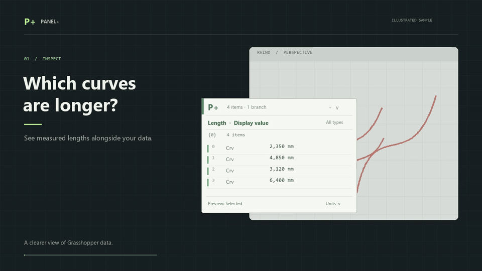
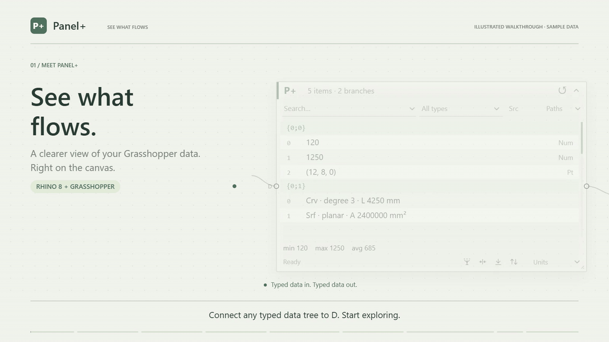
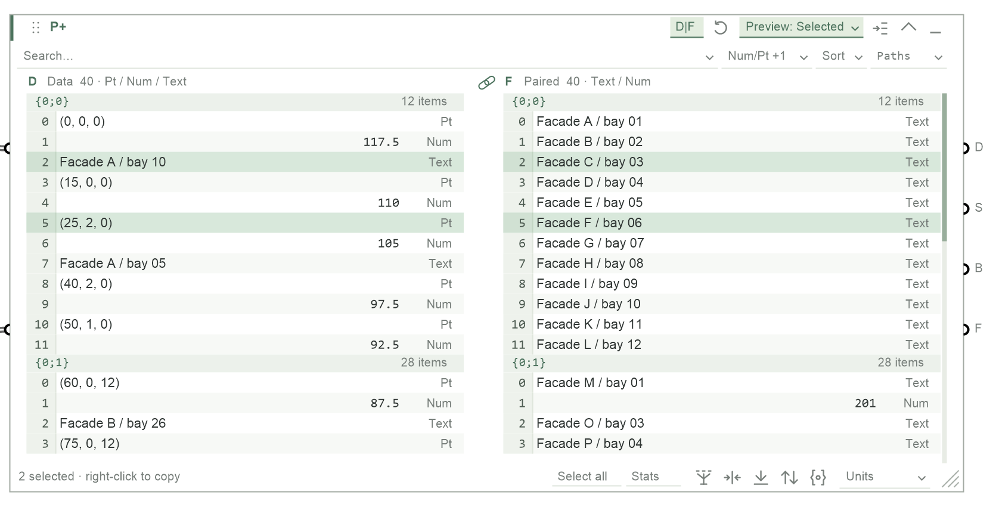
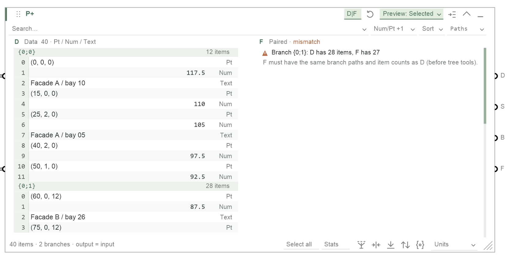

# Panel+

Created in [T3 Code](https://t3.codes).

**Panel+** (`panel-plus`) is a Grasshopper data inspector for Rhino 8 on Windows and Mac. Connect any data tree and see what flows: browse branches, measure geometry, search and filter, select rows to preview them in Rhino, and send exactly what you picked downstream.

[](docs/demo/panel-plus-short.mp4)

<sub>Illustrated sample data. [MP4 version](docs/demo/panel-plus-short.mp4).</sub>

## Install

Panel+ is published on Yak as **`panel-plus`** (beta). In Rhino 8, run `PackageManager`, tick **Include pre-releases**, search for `panel-plus` and install. Or close Rhino and run:

```text
yak install panel-plus 0.2.1-beta
```

If the earlier `better-gh-panel` package is installed, remove it first so the two copies don't both load. Find **Panel+** in **Params → Util** and connect a tree to **D**. Release notes for every version are on [GitHub Releases](https://github.com/tsoumdoa/better-gh-panel/releases).

## One-minute tour

[](docs/demo/panel-plus-demo.mp4)

<sub>Captioned, silent, illustrated sample data. [MP4](docs/demo/panel-plus-demo.mp4) · [日本語版 / Japanese](docs/demo/panel-plus-demo-ja.mp4) · run `npm run demo` for the editable animation ([source and recording notes](docs/demo/README.md)).</sub>

## What's new

**[`0.2.1-beta`](https://github.com/tsoumdoa/better-gh-panel/releases/tag/v0.2.1-beta)**

- **D | F split view.** Inspect paired data beside the data it belongs to — see [below](#d--f-split-view).
- **Row selection fix.** Rows could intermittently ignore clicks at some canvas zoom levels; they are now reliably selectable.

**`0.2.0-beta`** renamed the plugin to Panel+ (`panel-plus`). Earlier changes are listed in [Releases](https://github.com/tsoumdoa/better-gh-panel/releases).

## Features


### Inspect

- **Typed rows grouped by branch.** Branch headings show their path and item count; rows show compact type labels (**Pt**, **Crv**, **Srf**, **Brep**, **Mesh**, **Num**, …), empty branches, `<empty>` text and geometry-group names with their object counts.
- **Geometry metrics, automatically.** Visible curves, surfaces, Breps and meshes are measured in the background — length, area, volume and shape hints such as **Srf · untrimmed · planar · A 100 mm²**. Rows show **measuring…** until ready, and Panel+ never moves the camera.
- **Invalid and unverified values are marked** with a label, a **!** or **?** badge and the reason in the tooltip.
- **Counts and Stats.** The footer shows matched/total items and branches. **Stats** lists min/max/average plus every unique value with its frequency.
- **Long values** open in a read-only, scrollable **View full value** window from the row's right-click menu.

### Search, filter and sort

Type in the search field: rows update as you type, **Enter** applies the query and **Esc** restores the previous one. The search dropdown picks what to match:

| Mode | Example |
| --- | --- |
| Text (values, paths, types) / regular expression | `facade`, `^A-0[1-4]` |
| Numeric value, Length, Area, Volume, X/Y/Z | `> 4000`, `<= 25`, `!= 0` |
| List length · per branch | `>= 3`, `= 0` |
| Input-specific properties (below) | `>= 2`, `>= 2026-01-01` |

Comparisons use full precision in the units shown. Picking a mode shows its value (or list length) in each row; click the search field to filter by it — Validity and true/false properties are picked from a list (Valid, Invalid, Unverified, Null / True, False). Combine searches with the **Types** filter (including *invalid only*) and **Paths** (`0;2;4` or `{0;2;4}`, including descendants). **Asc/Desc** sorts within each branch and adds Excel-style row numbers; wire outputs always keep tree order.

<details>
<summary>Selectable properties by input type</summary>

| Input | Properties |
| --- | --- |
| Curves, lines, arcs, circles | Degree, closed, shape and planar; polyline segment count; radius and arc angle |
| Breps / meshes | Face and vertex counts, closed; Brep edge count and solid; planarity for single-face Breps |
| Surfaces | Face count; trimmed, U/V degree and planar for single-face surfaces |
| Rectangles / boxes | Width, height; rectangle perimeter; box depth and surface area |
| Vectors / planes | Vector magnitude; plane origin and axis components |
| Groups | Name and direct object count |
| Colours / domains | R/G/B/alpha and named colour; domain endpoints |
| Text / Boolean / GUID / time | Text value and length; Boolean/GUID value; date-time and its parts |
| Complex numbers / transforms | Real, imaginary, magnitude, phase; determinant and matrix entries |
| SubD / extrusion / point cloud | Vertex/edge/face counts, solid/closed; extrusion height and profiles; point count |
| Every input | Data type, validity, branch path and zero-based item index |

Unsupported properties show `n/a`. Text comparisons are exact; quote text to keep surrounding spaces (`= " 001 "`).

</details>

### Reshape the tree

The footer's tree tools run in a fixed order — **Simplify → Trim → Flatten → Reverse** — then unit conversion, filters and **Create set**:

- **Create set** keeps one entry per displayed value (per branch, or across the tree with Flatten). An occurrence badge such as **9×** expands to list every original path and index.
- **Units** converts numbers and geometry metrics (mm ↔ m, mm² ↔ m², mm³ ↔ m³, rad ↔ deg), sets **Decimal places**, and can **Round up by factor**. Geometry coordinates are never scaled.
- **Reset** returns to the incoming data in one click; one Undo restores your settings.

### Select, preview and copy

- **Click** a row to select it, **Ctrl/Cmd-click** to toggle, **Shift-click** for a range, a **branch heading** for the whole branch, and **Alt/Option-click** to pick the same item index in every branch. **Select all** takes every current match.
- **Preview** draws **Selected** rows (default), all **Filtered results**, or nothing, in Grasshopper's selection colour. **Show item order** adds numbered dots in Rhino.
- **Right-click** a row to **Frame selection** in Rhino, **Copy value(s)**, **View full value**, or **Copy geometry for Rhino** (Windows) to paste with Rhino's normal Paste.

### D | F split view

Connect matching data to the optional **F** input and click **D|F** in the header. The panel doubles in width and shows F's values beside D, row for row, through the same tree tools, filters, sorting and selection — for example, which named facade panels passed a length filter.



- **Linked scrolling** (the chain link between the pane captions) moves both panes with one scrollbar. Unlink it to scroll each pane on its own; selecting a row brings its partner into view, and relinking snaps F back to D.
- Copying and **View full value** from the F pane use F's raw values, unconverted.
- F must have **exactly the same branch paths and item counts as D** (before tree tools). If it doesn't, the F pane says where the trees first differ:



The **D|F** chip is hidden until F has data. Split view saves with the definition and supports Undo.

### Outputs

| Port | Output |
| --- | --- |
| **D** | Every matching item, typed, in tree order — or the unique displayed values when Create set is on. |
| **S** | Only the selected rows. Empty when nothing is selected. |
| **B** | A True/False mask in the original D tree shape: which input items survived. |
| **F** | The F input's items that pair with the surviving D items, in D's output order. |

Right-click the component → **B + F source** to make B and F follow the **Filtered results** (default) or only the **Selected rows**. In Selected mode the port labels read **B·S** and **F·S**. With nothing filtered or transformed, D forwards its input unchanged.

### Layout

- Drag the dotted header grip to move the panel and the bottom-right corner to resize it. The header chevron toggles **Full ↔ Half** height; **–** minimizes it to a capsule that still shows counts. Wires stay connected throughout.
- On a dark Grasshopper canvas Panel+ uses a matching dark palette. Below 50% zoom it shows a large item/branch summary.

### Keyboard and mouse

Click inside the panel to focus it (a green ring appears). Without focus, every key and wheel event goes to Grasshopper as usual.

| Key | Action |
| --- | --- |
| **↑ / ↓** (+ **Shift**) | Move (or extend) the selection |
| **PgUp / PgDn / Home / End** | Scroll |
| **Ctrl/Cmd + C** | Copy the selected values (Grasshopper objects when no rows are selected) |
| **Ctrl/Cmd + A** | Select all rows |
| **Ctrl/Cmd + F** or **/** | Search |
| **Esc** | Clear the selection, then release focus |
| Mouse wheel | Scroll the rows or menu under the pointer; hold any modifier to zoom the canvas instead |

## Development

```text
npm run check
```

Runs the core tests, native coordinator and packaging checks, builds and stages both Rhino runtimes, and verifies there is no unused code or non-UTF-8 C# source. It doesn't launch Rhino. Run it before opening or merging a PR; GitHub Actions CI is disabled.

To build a Yak package, run `dotnet build BetterGhPanel.sln -c Release` then `node scripts/package.mjs`. Native Rhino regressions run with `tests/BetterGhPanel.RhinoSmoke/run.ps1` (`-Fixture <name>` for one). See:

- [Build, packaging and release validation](docs/packaging.md)
- [Current architecture](docs/current-architecture.md) and [maintainability guide](docs/maintainability.md)
- [Geometry measurement](docs/geometry-measurement-safety.md) and [preview](docs/geometry-preview-safety.md) safety

The original interactive HTML design study is preserved in `prototype/` (`npm start`, then <http://localhost:5173>); it uses generated data and is a visual reference only.

## License

[MIT](LICENSE). The license is also included in locally generated Yak packages.
