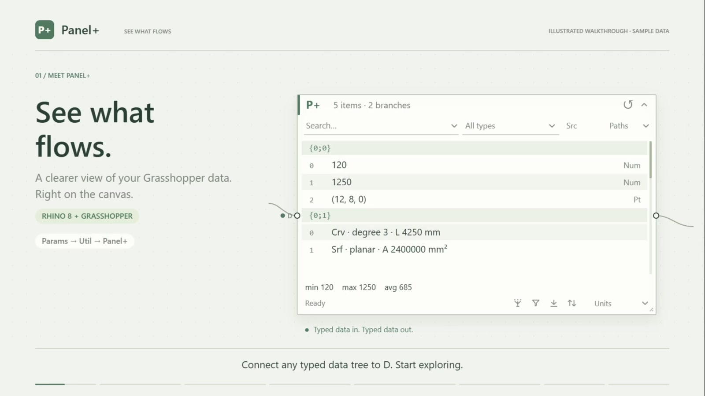
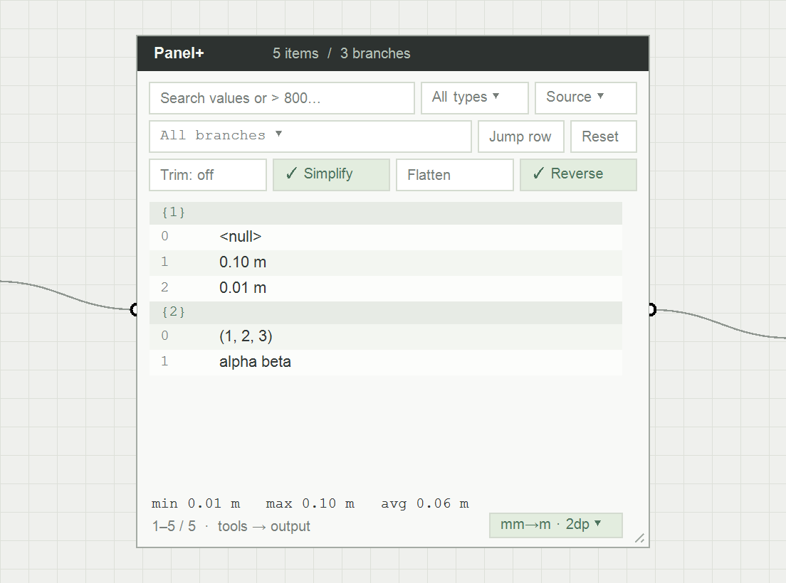

# better-gh-panel

Created in [T3 Code](https://t3.codes).

**Panel+** is a Grasshopper data inspector for Rhino 8 on Windows and Mac. This repository contains the native MVP and the original interactive HTML design study.

[Watch the one-minute animated tour](docs/demo/panel-plus-demo.mp4) for filtering, geometry measurements and selection, tree tools, units, and layout controls. The video uses illustrated sample data and includes captions. Run `npm run demo` for the editable animation and chapter controls; see [the demo source and recording notes](docs/demo/README.md).

[日本語版の動画はこちら / Japanese version](docs/demo/panel-plus-demo-ja.mp4) — Japanese titles, captions, and explanations, with the original plugin control names.

[](docs/demo/panel-plus-demo.mp4)

## Native MVP

Find **Panel+** in **Params → Util** after installing the local Yak package. Connect any typed tree to **D**. The output applies **Simplify → Trim → Flatten → Reverse → unit conversion → filters**. Search, type, invalid and branch filters keep only matching typed items on the output wire. Sorting and decimal formatting affect the view; output retains its transformed tree order and full precision. With all operations and filters off, the output forwards the input unchanged.

Beta **`0.1.17-beta`** adds Excel-style row numbers automatically in **Asc/Desc**. The large number is the position in the current filtered view, starting at 1; the smaller bracketed number is the original zero-based item index within its branch. Both share a fixed gutter sized from the complete input tree, so sorting, filtering and scrolling do not resize it. Row numbers, branch paths and values share a baseline; the small index sits 2 canvas units below it. Numeric values are right-aligned in a monospaced font, with aligned decimals when a fixed decimal setting is used. Rows stay 17 canvas units high and there is no extra toggle. Source order shows the original index alone and reserves the same gutter and path slot. Hover identifies the view row and full tree address. Sorting and numbering leave output order intact.

[See the native sorted numbering](docs/images/panel-row-numbering.png) and [the compact Half layout](docs/images/panel-row-numbering-half.png). The [interactive alignment study](prototype/sort-numbering.html) shows the approved layout with sample data.

Beta **`0.1.16-beta`** added a **Preview** dropdown with **Selected** (default), **Filtered results**, and **Off**. Row selection keeps the camera still; use **Frame selection** to zoom to selected geometry. It also fixed framing for custom preview data, pending copy status on document switches, and row actions while results are stale or the component is disabled.

Panel+ hides old rows, counts, type summaries and statistics behind **Recomputing…** and an animated spinner whenever input or a pending query changes. Managed queries get a 120 ms UI time budget, regardless of tree size. Queries that need longer resume their scan, statistics and sorting in the background without restarting. This is a cooperative deadline checked between operations; an operation already in progress finishes before yielding. Regex and geometry filters start in the background because individual operations cannot yield midway. A pending or invalid output filter produces an empty tree until its current result is ready; completion schedules a Grasshopper solution so downstream components update automatically. Reset restores the full input. Disabled components show **Disabled** and stop animating until re-enabled.

[See the native recomputing state](docs/images/panel-recomputing.png).

The public Yak beta is **`better-gh-panel 0.1.17-beta`**. In Rhino 8, run `PackageManager`, enable prereleases, and search for `better-gh-panel`. Or close Rhino and run `yak install better-gh-panel 0.1.17-beta`, then restart. Managed Grasshopper tree checks and Windows Rhino 8.35 host checks pass, including sorted and filtered row numbering, row jumps, compact Half layout, preview scopes, selection without camera movement, explicit framing, filtered output, disabled-state recovery and fixed wire connections. Mac runtime validation is pending.

Beta **`0.1.15-beta`** adds current-result loading states, resumable queries with a 120 ms time budget, and filters on typed output after tree tools and unit conversion. Whitespace-only regex patterns filter output correctly; internalised geometry preview respects filters.

Beta **`0.1.14-beta`** includes the icon and footer update below; plugin behavior is unchanged from `0.1.13-beta.1`.

Beta patch **`0.1.13-beta.1`** replaces the tree-tool bitmaps with thin vector icons in Panel+'s muted grey and green palette. Active tools use a soft green fill and underline. The footer aligns status text, icons and Units on one center line, with matching text styles and tighter spacing below the statistics.

Beta patch **`0.1.12-beta.1`** adds Grasshopper-style green highlighting for selected rows, branch selection and framing, and compact filters for numeric values, length, area, volume and regular expressions. Use the search dropdown to choose a mode and comparison. Select rows with Ctrl/Cmd-click or Shift-click, or click a branch heading to select its matching rows. Right-click for framing and value/geometry copying.

The panel measures visible curves, surfaces and Breps automatically in the background. Rows show **measuring…** while pending, then add the cached length, area or volume to the existing geometry summary. Trimming, curve degree, segment count and Brep face count stay visible after measurement; curves and single-face surfaces also gain shape or planarity hints. For example, a row shows **Srf · untrimmed · planar · A 100 mm²**. Hover for labeled details such as surface U/V degree or Brep edge and vertex counts; the metric appears once at the top. No Measure button or row selection is needed. **Units** converts geometry metrics, including volume (mm³ ↔ m³). Invalid geometry has a visible **Invalid** label and a tooltip with its reason.

**Simplify**, **Trim**, **Flatten**, and **Reverse** change the typed output and run in that order. Click Trim and enter a nonnegative depth (0 disables it); click the other tools to toggle them. Simplify removes shared path indices before Trim removes trailing path levels and merges matching branches; fully trimmed paths become `{0}`. Flatten merges into `{0}`, and Reverse reverses items within each output branch. Upstream data stays intact. Tool settings are saved with the definition and support undo. **Reset** restores the original incoming data: it disables every tree tool and unit conversion, restores automatic decimals, clears search, filters, sorting and row selection, and scrolls to the top. It closes dropdowns and discards pending text edits on the first click. One Undo restores the previous settings. Panel dimensions, display mode, preview mode and wire connections are retained. The component menu also offers **Reset panel view** and **Reset tree tools** for narrower resets.

New panels start at **360 × 360** (1:1). Saved sizes and legacy size presets are preserved. Drag the dotted header beside **P+** to move the panel; its padded target has a move cursor. The bottom-right resize handle has a 24 × 24 canvas-unit target, with footer controls kept clear of it. Full and Half resizing follows the cursor. All interaction stays on the canvas; the popup inspector has been removed.

One small chevron in the header toggles **Full ↔ Half**. Full restores the saved height and Half shows half that height. Both connection points stay fixed. Width, filters, selection, and data stay intact. The display mode is saved with the definition and supports undo. Resizing in Half updates the full height proportionally. Definitions saved with the removed Collapsed mode reopen in Full.

The panel uses a compact spreadsheet layout: one search/filter row and a small footer dock with Panel+'s own vector **Trim**, **Simplify**, **Flatten**, and **Reverse** icons. Hover for each tool's name and trim depth; green icons, a soft fill and an underline indicate active tools. Type hints cover Grasshopper geometry and primitive data: **Pt**, **Srf**, **Mesh**, **Crv**, **Brep**, **SubD**, **Vec**, **Num**, and more. The filter summarises the two most common visible types, with a remaining-type count, and its tooltip lists full names and counts. Mixed and invalid-only rows show compact type labels. Geometry summaries already name their type, so they use that space for metadata instead of repeating a type label. The menu retains full names, and other built-in or third-party types keep their own names. At the default size, the table has 41% more area than the previous layout.

The small **Units** dropdown at the bottom right opens upward inside the panel. Choose **mm ↔ m**, **mm² ↔ m²** (area), **mm³ ↔ m³** (volume), or **rad ↔ deg**. Conversion changes Number and Integer output values; converted integers become Numbers so fractions are preserved. Text, geometry, nulls, and empty branches pass through. Geometry metrics use the same menu for display only, applying a conversion only when its source model units and dimension match. Length, area and volume are separate: 1,000 mm, 1,000,000 mm² and 1,000,000,000 mm³ become 1 m, 1 m² and 1 m³ respectively. Conversion follows the tree tools, and search, sorting, and statistics use converted numeric values.

The same dropdown offers **Decimals: automatic** and **Decimal places…** (0–12). Decimal places format geometry metrics, numeric rows, copied numeric values, and statistics without rounding the values on the output wire. Conversion and decimal settings are saved with the definition and support undo. Existing definitions default to no conversion and automatic decimals. The header Reset clears these settings too; the explicit Reset panel view and Reset tree tools menu commands retain them. Dropdowns use compact widths, aligned checkmarks and arrows, a divider between conversion and formatting, and hover highlights. Paging keeps every option reachable even in a minimum-size Half panel.

The resizable canvas panel shows grouped branch headers and compact rows, with search, numeric comparisons (`> 800`, `<= 25`, `= 10`), type/invalid filters, value sorting, branch selection, exact branch jumps such as `{0;2;4}`, row jumps, a logical scrollbar, and numeric statistics. Click the search field and press Enter to apply a query. Its dropdown offers **Text**, **Regex**, **Value**, **Length**, **Area**, and **Volume**. Measurement modes offer greater than, at least, less than, at most, equal, and not equal comparisons. You can also edit expressions directly (`>= 25`, `!= 0`); a number alone means equality. Text retains the original plain-text and numeric-search behavior. Regex matches captured value text, case-insensitively, with execution limits and readable errors for invalid or overly expensive patterns. Addresses describe the transformed tree before filtering, so retained rows keep their original branch and item references. Drag the bottom-right corner to resize; size and view settings are saved with the definition.

Geometry filters compare full-precision measurements in the units shown by the panel; decimal formatting never changes matches. **Length** covers lines, arcs and curves, and uses circumference for circles even when their row summary shows radius. **Area** covers rectangles, surfaces and open Breps. **Volume** covers boxes and closed solid Breps. These filters use the panel's primary geometry measurements; secondary measurements such as solid surface area, mesh measurements and unsupported geometry types are excluded. Filtering measures eligible offscreen rows through the same background queue before publishing the complete result to the panel and output. Changing the query cancels obsolete work. Type and branch restrictions combine with the measurement filter. Matching geometry keeps its original type and coordinates; the Units menu converts numeric output and geometry measurements, not geometry coordinates.

The header's **Preview** dropdown controls the geometry drawn by Panel+. **Selected** draws only selected geometry in Grasshopper's selected preview color (green by default); an empty selection draws nothing. **Filtered results** (shown as **Preview: Results** in the header) draws every matching geometry row, including offscreen rows, with selected rows highlighted and other matches in normal colors. Without filters it draws the full result. **Off** disables Panel+'s preview while retaining row selection for copying and framing. The mode is saved with the definition, supports undo, and is retained by Reset. New panels, older definitions without a saved mode, and unrecognized modes default to Selected. Grasshopper's component/global preview visibility still applies. Other components retain their own previews, so this does not isolate geometry across the definition.

[See the Preview menu](docs/images/panel-preview-menu.png) and [its minimum Half layout](docs/images/panel-preview-menu-half.png).

Click a geometry row to select it without moving the camera. Ctrl-click (Cmd-click on Mac) toggles rows, and Shift-click selects a range in the current sorted and filtered view. Clicking an already-selected row keeps the group. Double-click a row or branch heading, or click empty table, panel or canvas space, to clear selection. Clearing selection retains the **Filtered results** preview and leaves filters and output unchanged. Choose a branch in **Paths** or enter an exact path to filter the table and clear selection. Click a branch heading to select all its matching rows, including offscreen rows. Right-click and choose **Frame selection** to fit selected geometry in Rhino's active viewport. Sorting, filtering, selection and preview changes do not move the camera. Selection clears on reset, new input and document switches. Preview never selects or bakes Rhino document objects.

Right-click a row for **Frame selection**, **Copy value(s)**, or **Copy geometry for Rhino**. Right-clicking a selected row retains the selected group, and copies follow the displayed row order. Numeric values and geometry measurements copy as numbers only, using the selected conversion and decimal formatting. Other rows retain their full text. If an area, length or volume is still pending, copying waits for it, including selected rows offscreen; a failed measurement leaves the clipboard unchanged. Changing or clearing selection, query, units, or input cancels a pending copy.

**Copy geometry for Rhino** places supported valid geometry on the native Windows clipboard for Rhino's normal **Paste** command. It preserves source model units and geometry coordinates; numeric display conversions do not scale geometry. Non-geometric, invalid and unsupported rows are skipped and counted. Copying does not bake objects into the Rhino document. Mac native geometry copying and custom model unit systems are currently unsupported; value copying and viewport framing remain available. New solutions clear row selection; filtering drops hidden selections, and sorting retains the selected rows.



[See the compact units menu](docs/images/panel-units-menu.png).

[See the filter modes](docs/images/panel-filters.png), [comparison choices](docs/images/panel-filter-comparisons.png), and [native selected geometry preview](docs/images/panel-selection-preview.png). The preview shows green selected curves and tinted selected mesh faces beside normal red geometry, with upstream previews enabled in both drawing orders.

[See the asynchronous geometry metric](docs/images/panel-measure.png) and [invalid geometry label](docs/images/panel-invalid.png).

Primitive values, points/vectors, and cheap geometry properties have cached summaries. Rows automatically show analytic measurements for lines, arcs, circles, rectangles and boxes. General curves, surfaces and Breps request length, trimmed area or solid volume when their rows are visible or explicitly selected for value copying. Painting queues positions; after one short scrolling delay, the UI thread duplicates one geometry and a background worker measures that private copy. The queue continues without a delay for every row, and fast measurements share a repaint. Each panel runs one measurement at a time. Scrolling and canvas panning replace queued work so rows outside the visible canvas are skipped; an operation already running finishes and releases its copy. Results, including failures, remain cached until new geometry is solved. Obsolete results cannot enter a newer solution or a closed panel. Units and decimal changes reuse raw measurements, including pending work when sources still match. Metrics start in Rhino model units; matching conversions change their display only. Invalid rows have a text label and captured validity reason. Third-party data keeps a type summary; full text is formatted on demand when copied. Text search operates on captured summaries, excluding asynchronous metrics. Numeric statistics include finite Number/Integer values, and exclude NaN and infinity. This MVP inspects connected data; it does not author text like an unconnected stock Panel.

### Build and package

```text
dotnet build BetterGhPanel.sln -c Release
dotnet run --project tests/BetterGhPanel.Core.Tests -c Release
node scripts/package.mjs
```

The beta artifact is `artifacts/better-gh-panel-0.1.17-beta/better-gh-panel-0.1.17-beta-rh8_0-any.yak`. Packaging follows HopperWire's AECTooling metadata and `net48` / `net7.0` layout. See [installation and publishing preparation](docs/packaging.md). The packaging script builds locally; public publication uses an explicit Yak push.

The native plug-in compiles for both Rhino runtime modes; the C# query harness covers filters, stats, stable sorting, empty branches, cancellation, and large data. Mac runtime validation requires a Mac with Rhino.

Run the local checks before opening or merging a PR:

```text
npm run check
```

This runs the core and packaging checks, builds and stages both Rhino runtimes, and checks for unused parameters, private members, assignments, and imports. The diagnostics are explicitly enabled in `.editorconfig`. It runs locally on Windows or Mac and stops on the first failure. It does not launch Rhino or publish a package. GitHub Actions CI is disabled.

Periodic reviews still need to trace public APIs and reflection consumers and assess duplicate code and test value; static analysis cannot establish those on its own.

## Archived HTML design study

Run `npm start`, then open http://localhost:5173. No dependency installation is needed. Use the **Canvas / Inspector** switch to compare the compact component and expanded explorer.

Try searching `> 800`, filtering **Nulls**, sorting numbers, or entering `{0;2;4}` in the branch search and pressing Enter. The sample size menu switches between 65,536 and 262,144 generated items. `/` focuses search, `G` focuses branch search, and Escape resets the view. Select a row to inspect and copy its value. Filters and sorting only affect the view.

The files in `prototype/` are a preserved visual reference using generated data independently of Rhino. Its query behavior is illustrative; the C# core defines native behavior. See [the current architecture](docs/current-architecture.md) and [the original proposal](docs/architecture.md).
