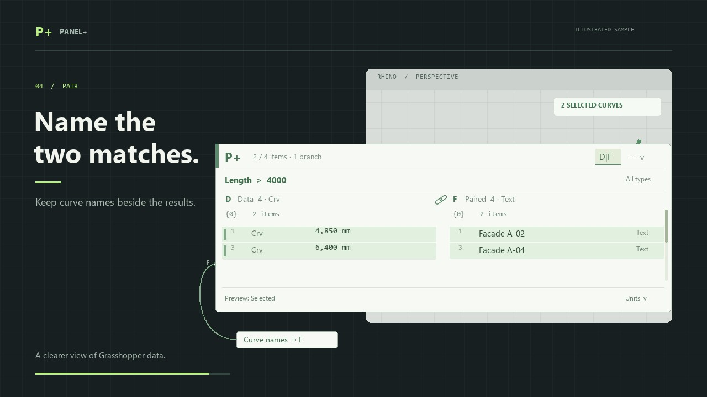

# Panel+

Created in [T3 Code](https://t3.codes).

**Panel+** (`panel-plus`) is a Grasshopper data inspector for Rhino 8 on Windows and Mac. This repository contains the native MVP and the original interactive HTML design study.

**See Panel+ in 15 seconds:** inspect curve lengths, filter them, and preview selected geometry. The animation uses illustrated sample data.

[](docs/demo/panel-plus-short.mp4)

[Watch the one-minute animated tour](docs/demo/panel-plus-demo.mp4) for filtering, geometry measurements and selection, tree tools, units, and layout controls. The video uses illustrated sample data and includes captions. Run `npm run demo` for the editable animation and chapter controls; see [the demo source and recording notes](docs/demo/README.md).

[日本語版の動画はこちら / Japanese version](docs/demo/panel-plus-demo-ja.mp4) — Japanese titles, captions, and explanations, with the original plugin control names.

[](docs/demo/panel-plus-demo.mp4)

## Native MVP

**D | F split view:** The **D|F** header toggle appears when F is connected; matching paths and item counts enable it. Inspect raw F values beside D with shared filters, sorting and selection. The chain-link control links scrolling through one right-edge scrollbar; unlink for independent scrolling, then relink to snap F to D. Mismatches show a diagnostic and pairing hint. Split view doubles the saved width, supports Undo and save/load, and survives Reset. Selected output scope is shown by **B·S / F·S** port labels.

**Patch `0.1.26-beta` — UI/UX audit fixes:** Panel+ now behaves more like a focused list while leaving Grasshopper's own gestures alone. [Release notes](https://github.com/tsoumdoa/better-gh-panel/releases/tag/v0.1.26-beta).

- **Keyboard focus is explicit.** Click inside the panel (not the dotted move grip or the wire-grip edges) to focus it; a green ring shows focus. While focused: **↑/↓** move the selection (**Shift** extends), **PgUp/PgDn/Home/End** scroll, **Ctrl/Cmd+C** copies the selected values, **Ctrl/Cmd+A** selects all rows, **Ctrl/Cmd+F** or **/** opens search, and in open menus **↑/↓/Enter/Esc** navigate. In the open **Paths** menu, typing digits and `;` narrows the branch list and Enter jumps to the typed path. **Esc** clears the selection, then releases focus; clicking elsewhere, minimizing or zooming below 50% releases it too. Without focus every key and wheel event reaches Grasshopper unchanged, and **Ctrl/Cmd+C** with no rows selected still copies Grasshopper objects.
- **Wheel scrolling.** While focused, the wheel scrolls rows or an open menu under the pointer. Holding any modifier, pointing outside the list, or a list that doesn't overflow leaves the wheel zooming the canvas as usual. The scrollbar's grab target is wider.
- **Live search.** Search and comparison editors update the rows as you type. The preview is view-only: Enter commits it as one undo step and updates the wire outputs; Esc or clicking away restores the previous query, selection and scroll without touching outputs, the document or Undo/Redo history. Saving during a preview keeps the committed query. Half-typed comparisons or regular expressions keep the previous view instead of flashing an error.
- **Clearer controls.** Search and Paths show a **×** to clear them. Jump has a "go to row" glyph, distinct from Flatten. Reset uses a counter-clockwise arrow and sits apart from Jump, and its footer notice says Undo restores the settings. Minimize is drawn as **–**, the capsule restore button as a window, and Simplify no longer uses a funnel that read as "filter". Sorting reads **Sort/Asc/Desc**, rounding reads **round 5**, and the footer reports **N filters on**, **tools on** or **output = input**. An input warning on the type filter is a drawn triangle.
- **Feedback.** Controls and rows highlight on hover, and clickable controls show a hand cursor. Invalid input in Trim, Decimal places, Round up by factor and Jump now explains itself in the footer instead of being ignored. Invalid and unverified rows add a **!** or **?** badge beside the colour bar. Tooltips are shorter.
- **Row menu.** Frame and Copy geometry are greyed out, with the reason in the tooltip, when the selection holds no geometry; Copy geometry is greyed out on Mac.
- **Layout.** Panels at least 500 units wide use a single-line footer when its text fits, gaining a row; longer summaries and notices keep two lines. Narrow panels shrink the type and Paths dropdowns before the search field. Below 50% zoom the panel shows its item and branch summary in large type instead of a blank body.
- **Scroll position survives upstream recomputes.** When an upstream change produces a tree with the same paths and branch lengths, the panel keeps its scroll position instead of jumping to the top. Row selection still clears, because an address may now hold different data and S/B/F must never emit items you did not pick. Tree tools, Reset and any change of shape start at the top as before.
- **Dark canvases.** When Grasshopper's canvas colour is dark, Panel+ mirrors its palette so it doesn't glare.

**Patch `0.1.25-beta` — selectable inspection properties:** The search dropdown now offers captured properties appropriate to the connected input. Select a property, then **Display value** or a comparison. Numeric/date properties support `>`, `>=`, `<`, `<=`, `=` and `!=`; Boolean/text properties support `=` and `!=`. Boolean thresholds are `True`/`False`. Text comparisons are exact and case-sensitive; quote text to preserve surrounding spaces (`= " 001 "`). Dates accept `yyyy-MM-dd` or `yyyy-MM-dd HH:mm:ss`, including fractional seconds, and compare stored calendar time without timezone conversion.

| Input | Additional selectable properties |
| --- | --- |
| Curves, lines, arcs, circles | Degree, closed, shape and planar; polyline segment count; radius for arcs/circles and arc angle |
| Breps / meshes | Face and vertex counts, closed; Brep edge count and solid; planarity for single-face Breps |
| Surfaces | Face count; trimmed, U/V degree and planar for single-face surfaces |
| Rectangles / boxes | Width (X) and height (Y); rectangle perimeter; box depth (Z) and surface area |
| Vectors / planes | Vector magnitude; plane origin XYZ and individual XYZ components of each axis |
| Groups | Name and direct object count |
| Colours / domains | R/G/B/alpha and named colour where available; domain endpoints or separate U/V endpoints |
| Text / Boolean / GUID / time | Text value and UTF-16 character count; Boolean/GUID value; date-time and year/month/day/hour/minute/second |
| Complex numbers / transforms | Real, imaginary, magnitude, phase; determinant and 16 matrix entries for empty or single stock matrix transforms |
| SubD / extrusion / point cloud | SubD vertex/edge/face counts and solid/closed; extrusion height, profile count and solid/closed; point-cloud count |
| Every input | Data type, validity, branch path and zero-based item index |

Captured counts stay unitless. Geometry distances/areas use matching model-unit conversions; arc angles and complex phase are radians, with radians-to-degrees conversion available. General-curve shape/planarity and surface planarity use the existing owned-copy measurement queue, including offscreen rows needed by filters and sets. Unsupported properties show `n/a`; pending/failed measurements and invalid/unverified inputs retain distinct labels. Saved properties remain visible when an input changes.

**Copy values** copies the displayed property. **Create set** emits displayed numbers for numeric properties and text for Boolean/text/date properties, preserving numeric-looking text such as `001`. Property display sorting uses the selected values; wire outputs retain transformed tree order. With Create set off, the original typed output and its statistics remain intact. Property display modes, including X/Y/Z, survive save/load and Undo. Third-party objects and compound/custom transforms retain safe summaries; this is not arbitrary property reflection.

**Patch `0.1.24-beta`:** [Release notes](https://github.com/tsoumdoa/better-gh-panel/releases/tag/v0.1.24-beta). Input-aware properties now include mesh area, closed-mesh volume, and X/Y/Z components for points and vectors. Solid Breps expose both volume and surface area. Choose a property in the search menu to compare or display it; Copy values copies that property, and Create set emits its displayed numbers. Geometry output stays typed with Create set off. **Units → Round up by factor…** rounds Number/Integer output toward positive infinity after conversion (factor `5`: `12.1 → 15`, `−12.1 → −10`). Enter a positive finite factor with a decimal point; **Rounding: off** disables it. Rounding affects numeric input values, filters, statistics and D/S output. Settings save with the definition and support Undo; Reset disables rounding. Geometry coordinates and measured properties retain their precision; rounding applies to numeric input values. Decimal places remain a separate display setting.

**Patch `0.1.23-beta`:** maintenance release with unchanged application behavior. Routine native smoke/UI tests and obsolete probes were removed; the release archive passed the retained 18 geometry safety and integrity regressions. Published on Yak and [GitHub Releases](https://github.com/tsoumdoa/better-gh-panel/releases/tag/v0.1.23-beta).

**Beta `0.1.22-beta`:** version-only successor to `0.1.21-beta`, with the same connected-data inspection features and fixes. Published on Yak and [GitHub Releases](https://github.com/tsoumdoa/better-gh-panel/releases/tag/v0.1.22-beta); the new archive passed all 66 required Windows Rhino fixtures.

**Beta `0.1.21-beta` — connected-data inspection and maintenance:** the search menu offers comparison modes supported by the primary input and retains an active saved mode when the input changes. Geometry groups show their name and direct object count. Empty branches remain visible, empty text is displayed as **<empty>** while its value stays empty, and a read-only full-value window makes long rows scrollable. Values whose validity cannot be verified are distinguished from invalid values; saved filters are preserved and can show an input warning. This candidate also reorganizes measurement ownership, selection indexing and native test isolation. Published on Yak and [GitHub Releases](https://github.com/tsoumdoa/better-gh-panel/releases/tag/v0.1.21-beta). The exact archive passed all 66 required Windows Rhino fixtures; earlier intermittent clipboard failures and remaining host coverage gaps are recorded in the release notes and [PR #37](https://github.com/tsoumdoa/better-gh-panel/pull/37).

**Patch `0.1.20-beta.7` — sets of displayed values:** after filters, unit conversion and decimal formatting, equal displayed values become one entry. D and S output the displayed numbers themselves (or displayed text for nonnumeric rows). For example, displayed curve lengths `6.28, 6.28, 2.00` become numeric `6.28, 2`; displayed list lengths `3, 3, 5, 0, 0` become `3, 5, 0`, including the zero from an empty branch. Item sets stay per branch; Flatten combines them. List-length sets group across branch rows and keep the first matching path for each count. Turn Create set off to restore the original typed values and precision. [List-length set](docs/images/panel-display-set-list-length.png) · [Geometry-length set](docs/images/panel-display-set-length.png).

**Patch `0.1.20-beta.6` — display filter values:** choose a numeric, geometry or **List length · per branch** mode in the search dropdown, then choose **Display value** alongside the comparison operators. No threshold is needed. List length shows one path/count row per branch, including empty branches, after tree tools and before item filters. Numeric value, Length, Area and Volume show the corresponding value per item using the current units and decimals; Length uses circle circumference. Unsupported items show **n/a**, and deferred geometry shows **measuring…** until ready. Type, invalid-only and Paths restrictions still apply. The choice saves with the definition and supports Undo; choose a comparison, edit the search, or Reset to return to the item view. With Create set off, wire outputs and statistics continue to describe the typed data, while Copy values in a per-item metric view copies the displayed metric without unit labels.

[See list lengths](docs/images/panel-display-list-length.png), [minimum Half view](docs/images/panel-display-list-length-half.png), and [geometry lengths](docs/images/panel-display-length.png).

**Patch `0.1.20-beta.5` — selected data, masks and paired outputs:** **D** keeps all filter matches, **S** emits selected rows, **B** marks original input membership, and the optional **F** input/output carries paired data through the primary tree tools and filters. Choose **Filtered results** (default) or **Selected rows** for B/F in the component menu. Existing definitions retain their D connections.

**Patch `0.1.20-beta.4` — maintenance:** unit definitions, query restrictions and row-menu actions now have shared owners, preserving existing output and interactions. See the [maintainability audit and feature guide](docs/maintainability.md).

**Patch `0.1.20-beta.3` — sorting within branches:** Asc/Desc sorts each branch independently and keeps branches in tree order. Branch headings remain visible when space permits. Copy follows the displayed order; output retains the transformed tree order and full precision. Sorted view numbers remain global for unambiguous row jumps, alongside each item's original branch index.

**Patch `0.1.20-beta.2` — consistent filters and values:** choose **List length · per branch** in the search menu to compare each branch's item count (`>= 3`, `= 0`, or `!= 1`). Counts describe the tree after Simplify, Trim, Flatten and Reverse, before item filters and Create set. Matching empty branches remain on the output unless a type or invalid-item filter excludes them. Paths accepts both `0;0;1` and `{0;0;1}`, including descendant selection.

Text and regex searches use the same converted, decimal-formatted value shown in the panel, including geometry measurements. Geometry searches also measure eligible offscreen rows before publishing results. Numeric and geometry comparisons use full precision. With Create set off, output contains the matching typed, converted values in transformed tree order without rounding. Create set outputs the displayed values at the displayed precision. Asc/Desc changes the view order. **Copy values** follows the current view order and decimal setting; numeric values and geometry measurements omit unit labels and use a decimal point for pasting. **Copy geometry** retains the actual geometry.

**Patch `0.1.20-beta.1` — set occurrence details:** Create set rows show an occurrence badge such as **9×**, with aligned columns and a separate expand arrow. Click the count or chevron to expand a small table below the panel; click it again, or the table's top-right chevron, to collapse. The compact summary shows occurrences and original input branches; the count's tooltip also shows duplicates removed. The table lists every occurrence's **input branch path** and **zero-based item index**, including the retained item. Previous/Next appears only for lists longer than four locations, including in minimum Half layout. [Interactive mock](docs/set-occurrences-mock.html).

Counts describe the matching displayed values grouped into that set row after filters, units and decimals. They are separate per output branch unless tree tools merge branches. Original locations survive Simplify, Trim, Flatten and Reverse, and remain attached to the correct value as sorting and filtering change; units and decimals can change grouping. Expansion and paging preserve selection, camera, output, panel size and wire grips. The table hides while zoomed out, recomputing, disabled or failed; filtering out its value or receiving new input closes it. Expansion is temporary view state. [Full view](docs/images/panel-set-occurrences.png) · [Minimum Half view](docs/images/panel-set-occurrences-half.png).

Beta **`0.1.20-beta`** publishes the Create set feature under the next beta version. Behavior is unchanged from `0.1.19-beta.3`: duplicates are removed within each branch, with Flatten available for one set across the whole tree.

Patch **`0.1.19-beta.3`** adds **Create set** beside Reverse in the footer. One click keeps the first occurrence of each exact value per branch on the typed output; click again to restore duplicates. Enable **Flatten** too for one set across the entire tree. The toggle works in Full and Half layouts, saves with the definition, and supports Undo and Reset.

[See Create set on the native canvas](docs/images/panel-create-set.png) and [in the minimum Half layout](docs/images/panel-create-set-half.png).

Create set compares the complete displayed text, including units and decimal formatting; text preserves case and whitespace. The first matching occurrence supplies the path and source location. Numeric values and metrics output numbers at the displayed precision; other values, including unsupported or unavailable metric labels, output text. Reversing changes the first occurrence, while sorting changes only the view order. Every required offscreen geometry measurement completes before the set is published. Occurrence badges list the original locations of matching displayed values after filters.

Patch **`0.1.19-beta.2`** corrects **Show item order** to use zero-based item indices within each branch. Filtering, sorting and partial selection preserve those indices; tree tools define the branch/index addresses. A visible **Select all** footer button selects every current matching row across branches, including offscreen rows, in Full and Half layouts. Selection keeps the camera and typed output unchanged.

Patch **`0.1.19-beta.1`** removes unused space to the left of source-order values. Grouped rows place values beside a compact original-index column instead of reserving hidden path and sorted-number slots. Sorted rows and panels too short for branch headings retain their inline paths.

Beta **`0.1.19-beta`** adds **Select index … across branches** to the row's right-click menu. **Alt-click** (Option-click on Mac) selects the clicked row's zero-based item index in every branch of the current results, including offscreen rows. Right-click an existing multi-row selection to expand all its distinct indices at once. Indices refer to the tree after tree tools and before filtering or sorting, not the large one-based display row numbers. Active search, type, invalid and Paths filters are respected; the menu says **across filtered results** when scoped. Shorter branches are skipped. The footer briefly reports the indices and selected item/branch counts; hover for the full status. Selection uses the existing preview, copy, frame and clear actions without changing the camera or output.

[See the native index-selection menu](docs/images/panel-index-selection-menu.png) and [its minimum Half layout](docs/images/panel-index-selection-half.png).

Beta **`0.1.18-beta`** adds easier row deselection, larger panel move/resize handles, total and per-branch item counts, and a **Stats** menu with exact unique numeric/text values and frequencies. The header **×** minimizes the panel to a compact capsule; its restore arrow reopens the same view. **Preview → Show item order** adds optional viewport labels at point locations or geometry bounding-box centers, with selected labels taking priority where they overlap. These presentation controls preserve typed output and camera position. The sections below include native screenshots and interaction details.

Find **Panel+** in **Params → Util** after installing the local Yak package. Connect any typed tree to **D**. The output applies **Simplify → Trim → Flatten → Reverse → unit conversion → filters → Create set**. Search, type, invalid and branch filters keep only matching typed items on the output wire. Output retains transformed tree order. Sorting affects the view; decimals also affect set equality and output precision when Create set is on. With Create set off, typed output retains full precision. With all operations and filters off, the output forwards the input unchanged.

Patch `0.1.20-beta.5` adds **S**, **B**, and **F** outputs alongside **D**, plus an optional **F** input:

| Port | Behavior |
| --- | --- |
| D output | All matching primary data, or unique displayed numbers/text when Create set is on. |
| S output | The selected subset of matching rows, in transformed tree order. No selection produces an empty tree. |
| B output | A Boolean membership tree with the original D input paths and item counts. True means the original item survives the chosen scope. |
| F input/output | Optional paired data, matched to the original D input by exact branch path and zero-based item index, then emitted in the primary transformed tree order. |

Right-click the component and choose **B + F source → Filtered results** (the default) or **Selected rows**. Filtered pairs F with D; Selected pairs F with S. In Selected mode, clearing the selection produces an all-False B and empty S/F. The scope saves with the definition and supports Undo/Redo without clearing the current selection; the selection itself is temporary. Reset restores Filtered scope. Sorting and click order never reorder wire outputs.

Paired F must have exactly the same paths and branch lengths as the original D input, including empty branches. A mismatch empties F and reports a warning while D, S and B remain available; leaving F disconnected needs no warning. Tree tools determine the paired output's paths and retained items. **Create set** keeps the partner of the first retained source occurrence, and B marks only that occurrence True. For displayed list-length sets, F keeps the matching items from the representative branch and B marks those items; a retained empty branch produces zero on D/S and has no B items. Thus list-count D/S and F can have different item counts. Unit conversion changes primary D/S values; paired F keeps its own types and values. B carries membership only, so using it on a separate stream does not reproduce transformed paths or ordering. Pending or failed output filters publish no stale masks, selections or paired results.

Port labels identify both inputs and all four outputs. Full/Half layouts share fixed grip positions, and the compact capsule has enough height for distinct output wire targets.

Beta **`0.1.17-beta`** adds Excel-style row numbers automatically in **Asc/Desc**. The large number is the position in the current filtered view, starting at 1; the smaller bracketed number is the original zero-based item index within its branch. Both share a gutter sized from the complete input tree, so filtering, scrolling and switching between Asc/Desc do not resize it. Row numbers, branch paths and values share a baseline; the small index sits 2 canvas units below it. Numeric values are right-aligned in a monospaced font, with aligned decimals when a fixed decimal setting is used. Rows stay 17 canvas units high and there is no extra toggle. Source order shows the original index in a compact gutter, with values directly beside it when paths are shown in branch headings. Inline paths remain visible when the panel is too short for headings. Hover identifies the view row and full tree address. Sorting and numbering leave output order intact.

[See the native sorted numbering](docs/images/panel-row-numbering.png) and [the compact Half layout](docs/images/panel-row-numbering-half.png). The [interactive alignment study](prototype/sort-numbering.html) shows the approved layout with sample data.

Beta **`0.1.16-beta`** added a **Preview** dropdown with **Selected** (default), **Filtered results**, and **Off**. Row selection keeps the camera still; use **Frame selection** to zoom to selected geometry. It also fixed framing for custom preview data, pending copy status on document switches, and row actions while results are stale or the component is disabled.

Panel+ hides old rows, counts, type summaries and statistics behind **Recomputing…** and an animated spinner whenever input or a pending query changes. Managed queries get a 120 ms UI time budget, regardless of tree size. Queries that need longer resume their scan, statistics and sorting in the background without restarting. This is a cooperative deadline checked between operations; an operation already in progress finishes before yielding. Regex and geometry filters start in the background because individual operations cannot yield midway. A pending or invalid output filter produces an empty tree until its current result is ready; completion schedules a Grasshopper solution so downstream components update automatically. Reset restores the full input. Disabled components show **Disabled** and stop animating until re-enabled.

[See the native recomputing state](docs/images/panel-recomputing.png).

The Yak beta is **`panel-plus 0.2.0-beta`**. In Rhino 8, run `PackageManager`, enable prereleases, and search for `panel-plus`. Or close Rhino and run `yak install panel-plus 0.2.0-beta`, then restart. If the previous `better-gh-panel` package is installed, remove it first to avoid loading both copies. See [release validation](docs/packaging.md) for the retained native regression coverage, known intermittent host/clipboard failures and remaining platform coverage.

Beta **`0.1.15-beta`** adds current-result loading states, resumable queries with a 120 ms time budget, and filters on typed output after tree tools and unit conversion. Whitespace-only regex patterns filter output correctly; internalised geometry preview respects filters.

Beta **`0.1.14-beta`** includes the icon and footer update below; plugin behavior is unchanged from `0.1.13-beta.1`.

Beta patch **`0.1.13-beta.1`** replaces the tree-tool bitmaps with thin vector icons in Panel+'s muted grey and green palette. Active tools use a soft green fill and underline. The footer aligns status text, icons and Units on one center line, with matching text styles and tighter spacing below the statistics.

Beta patch **`0.1.12-beta.1`** adds Grasshopper-style green highlighting for selected rows, branch selection and framing, and compact filters for numeric values, length, area, volume and regular expressions. Use the search dropdown to choose a mode and comparison. Select rows with Ctrl/Cmd-click or Shift-click, or click a branch heading to select its matching rows. Right-click for framing and value/geometry copying.

The panel measures visible curves, surfaces and Breps automatically in the background. Rows show **measuring…** while pending, then add the cached length, area or volume to the existing geometry summary. Trimming, curve degree, segment count and Brep face count stay visible after measurement; curves and single-face surfaces also gain shape or planarity hints. For example, a row shows **Srf · untrimmed · planar · A 100 mm²**. Hover for labeled details such as surface U/V degree or Brep edge and vertex counts; the metric appears once at the top. No Measure button or row selection is needed. **Units** converts geometry metrics, including volume (mm³ ↔ m³). Invalid geometry has a visible **Invalid** label and a tooltip with its reason.

**Simplify**, **Trim**, **Flatten**, and **Reverse** run in that order before unit conversion and filters. **Create set** then outputs unique displayed values. Click Trim and enter a nonnegative depth (0 disables it); click the other tools to toggle them. Simplify removes shared path indices before Trim removes trailing path levels and merges matching branches; fully trimmed paths become `{0}`. Flatten merges into `{0}`, and Reverse reverses items within each output branch. Upstream data stays intact. Tool settings are saved with the definition and support undo. **Reset** restores the original incoming data: it disables every tree tool and unit conversion, restores automatic decimals, clears search, filters, sorting and row selection, and scrolls to the top. It closes dropdowns and discards pending text edits on the first click. One Undo restores the previous settings. Panel dimensions, display mode, preview mode and wire connections are retained. The component menu also offers **Reset panel view** and **Reset tree tools** for narrower resets.

New panels start at **360 × 360** (1:1). Saved sizes and legacy size presets are preserved. Drag the dotted header beside **P+** to move the panel; its padded target has a move cursor. The bottom-right resize handle has a 24 × 24 canvas-unit target, with footer controls kept clear of it. Full and Half resizing follows the cursor. All interaction stays on the canvas; the popup inspector has been removed.

The footer shows **item and branch counts**, with **matched/total** counts while filtering. Totals describe the tree after structural tools and numeric unit conversion, before filters and Create set. List-length sets show values counted against the source branches; their statistics describe the emitted counts. Branch headings show each branch's item count using the same scope; **Paths** lists every available branch with its total count, including empty branches. Counts measure list/tree length, not summed geometry length.

Use the single **Stats** button for numeric minimum, maximum and average, validity/type counts, and the **unique numeric/text values with frequencies**. The menu opens upward and uses Previous/Next paging so the complete set remains reachable in minimum-size Half mode. Hover a value for details. Statistics use the displayed output values when Create set is on. Otherwise unique values retain first source occurrence order and exact numeric precision, independent of sorting and decimal formatting; Integer `1` and Number `1.0` share a value. Text preserves case, whitespace and empty strings, and stays separate from numbers. Null, invalid, nonfinite and other data types are excluded from unique values and their excluded count is shown. Opening Stats does not change selection, filters or output. Pending, failed and disabled states hide old statistics.

One small chevron in the header toggles **Full ↔ Half**. Full restores the saved height and Half shows half that height. Both connection points stay fixed. Width, filters, selection, and data stay intact. The display mode is saved with the definition and supports undo. Resizing in Half updates the full height proportionally. Definitions saved with the removed Collapsed mode reopen in Full.

The header **–** minimizes the panel to a small capsule with the same current/total item and branch counts as the footer. The capsule's window button reopens the same Full or Half view, preserving the saved size, row selection, scroll position, filters and geometry preview. Minimize closes menus and discards the panel's pending text edit. The wire grips move to the capsule edges and return to their original positions when restored; the wires stay connected. The minimized state is saved separately and supports undo/redo without recomputing output. Disabled, recomputing and failed filters show their status instead of stale counts. **Minimize to capsule / Restore panel** is also available in the component menu.

[See the native capsule](docs/images/panel-capsule.png) and [the restored Half panel with counts and handles](docs/images/panel-feedback-half.png).

The panel uses a compact spreadsheet layout: one search/filter row and a small footer dock with Panel+'s own vector **Trim**, **Simplify**, **Flatten**, **Reverse**, and **Create set** icons. Hover for each tool's name and trim depth; green icons, a soft fill and an underline indicate active tools. Type hints cover Grasshopper geometry and primitive data: **Pt**, **Srf**, **Mesh**, **Crv**, **Brep**, **SubD**, **Vec**, **Num**, and more. The filter summarises the two most common visible types, with a remaining-type count, and its tooltip lists full names and counts. Mixed and invalid-only rows show compact type labels. Geometry summaries already name their type, so they use that space for metadata instead of repeating a type label. Known built-in types retain their full names. If a value's type or validity cannot be safely determined, Panel+ marks it as unverified; an active filter may exclude it, and the Types tooltip explains the warning. At the default size, the table has 41% more area than the previous layout.

Grasshopper geometry-group data shows its name and direct object count, for example **Group (Facade A) with 2 objects**. Search and Create set use that summary. With Create set off, the output retains the original group value. Empty text appears as **<empty>** in the table but remains empty for search, copy and output. Empty branches remain visible in the table. Panel+ inspects connected data; it does not become a text editor when disconnected.

The small **Units** dropdown at the bottom right opens upward inside the panel. Choose **mm ↔ m**, **mm² ↔ m²** (area), **mm³ ↔ m³** (volume), or **rad ↔ deg**. Conversion changes Number and Integer output values; converted integers become Numbers so fractions are preserved. Text, geometry, nulls, and empty branches pass through. Geometry metrics use the same menu for display only, applying a conversion only when its source model units and dimension match. Length, area and volume are separate: 1,000 mm, 1,000,000 mm² and 1,000,000,000 mm³ become 1 m, 1 m² and 1 m³ respectively. Conversion follows the tree tools, and search, sorting, and statistics use converted numeric values.

The same dropdown offers **Decimals: automatic** and **Decimal places…** (0–12). Decimal places format geometry metrics, numeric rows, copied numeric values, and statistics without rounding the values on the output wire when Create set is off. With Create set on, decimals regroup the displayed values and update the output numbers. Changing decimals also refreshes an active text or regex filter, since it searches the formatted value, and updates downstream membership when needed. Numeric comparisons continue using full precision. Conversion and decimal settings are saved with the definition and support undo. Existing definitions default to no conversion and automatic decimals. The header Reset clears these settings too; the explicit Reset panel view and Reset tree tools menu commands retain them. Dropdowns use compact widths, aligned checkmarks and arrows, a divider between conversion and formatting, and hover highlights. Paging keeps every option reachable even in a minimum-size Half panel.

The resizable canvas panel shows grouped branch headers and compact rows, with search, numeric comparisons (`> 800`, `<= 25`, `= 10`), type/invalid filters, value sorting, branch selection, exact branch jumps such as `0;2;4` or `{0;2;4}`, row jumps, a logical scrollbar, and numeric statistics. Click the search field and type: rows update as you type, Enter applies the query and Esc cancels it. Its dropdown always offers **Text**, **Regex** and **List length · per branch**, and adds **Value**, **Length**, **Area**, **Volume** or **X/Y/Z** when supported by at least one item in the transformed input. A saved active mode remains available if the input changes. Comparison modes offer greater than, at least, less than, at most, equal, and not equal. You can also edit expressions directly (`>= 25`, `!= 0`); a number alone means equality in comparison modes. Text searches displayed values, paths and types, while numeric comparison expressions use full precision. Regex matches displayed value text, case-insensitively, with execution limits and readable errors for invalid or overly expensive patterns. Stable measurement failures are searchable as **measurement unavailable**. Addresses describe the transformed tree before filtering, so retained rows keep their original branch and item references. Drag the bottom-right corner to resize; size and view settings are saved with the definition.

Geometry filters compare full-precision measurements in the units shown by the panel; decimal formatting never changes matches. **Length** covers lines, arcs and curves, and uses circumference for circles even when their row summary shows radius. **Area** covers rectangles, surfaces, open or solid Breps, and open or closed meshes. **Volume** covers boxes, closed solid Breps and closed meshes. **X/Y/Z** compare or display captured point/vector components, including negative values. Matching length conversions apply to components in model units. Unsupported rows are excluded from property comparisons and show **n/a** in Display value. Filtering measures eligible offscreen rows through the same background queue before publishing the complete result to the panel and output. Changing the query cancels obsolete work. Type and branch restrictions combine with the measurement filter. With Create set off, matching geometry keeps its original type and coordinates; the Units menu converts numeric output and geometry measurements, not geometry coordinates.

The header's **Preview** dropdown controls the geometry drawn by Panel+. **Selected** draws only selected geometry in Grasshopper's selected preview color (green by default); an empty selection draws nothing. **Filtered results** (shown as **Preview: Results** in the header) draws every matching geometry row, including offscreen rows, with selected rows highlighted and other matches in normal colors. Without filters it draws the full result. **Off** disables Panel+'s preview while retaining row selection for copying and framing. The mode is saved with the definition, supports undo, and is retained by Reset. New panels, older definitions without a saved mode, and unrecognized modes default to Selected. Grasshopper's component/global preview visibility still applies. Other components retain their own previews, so this does not isolate geometry across the definition.

[See the Preview menu](docs/images/panel-preview-menu.png) and [its minimum Half layout](docs/images/panel-preview-menu-half.png).

Enable **Preview → Show item order** to place small numbered dots in Rhino. Numbers are **zero-based item indices within each branch**, taken from the tree after tree tools and before filtering or sorting. Each branch starts at `0`; filtering, sorting and selected subsets preserve those indices. Non-geometric or invalid items still occupy their branch indices, so visible labels can have gaps. Points use their actual locations; curves, surfaces and volumes use their bounding-box centers. The row tooltip identifies the matching branch path and item index when labels are enabled. Labels follow the existing **Selected / Filtered results / Off** preview scope, remain active in the minimized capsule, and clear while data is pending or invalid. The setting defaults off, is saved with the definition, and supports undo without recomputing or changing selection, output, geometry or the camera. Nearby overlapping labels are hidden, with selected rows taking priority; zoom in or select fewer rows to separate them.

[See native item-order labels](docs/images/panel-item-order.png) and [the toggle in the minimum Half panel](docs/images/panel-item-order-menu-half.png). Labels stay legible above shaded surfaces and disappear when their panel's native preview is hidden.

Click **Select all** beside Stats to select every current matching row across branches, including offscreen rows. Active filters are respected. [See Select all in the minimum Half layout](docs/images/panel-select-all-half.png). Click a geometry row to select it without moving the camera. Ctrl-click (Cmd-click on Mac) toggles rows, and Shift-click selects a range in the current sorted and filtered view. Clicking an already-selected row keeps the group. Double-click a row or branch heading, or click empty table, panel or canvas space, to clear selection. Clearing selection retains the **Filtered results** preview and leaves filters and output unchanged. Choose a branch in **Paths** or enter an exact path to filter the table and clear selection. Click a branch heading to select all its matching rows, including offscreen rows. Right-click and choose **Frame selection** to fit selected geometry in Rhino's active viewport. Sorting, filtering, selection and preview changes do not move the camera. Selection clears on reset, new input and document switches. Preview never selects or bakes Rhino document objects.

Right-click a row for **Frame selection**, **Copy value(s)**, **View full value**, or **Copy geometry for Rhino**. The full-value window is read-only and scrollable, so long or multiline text remains accessible while table rows stay fixed in height. Right-clicking a selected row retains the selected group, and copies follow the displayed row order. Numeric values and geometry measurements copy as numbers only, using the selected conversion and decimal formatting. Text rows retain their full content even when visually clipped; other rows copy their displayed summary, including invalid markers. If an area, length or volume is still pending, copying waits for it, including selected rows offscreen; a failed measurement leaves the clipboard unchanged. Changing or clearing selection, query, units, or input cancels a pending copy.

**Copy geometry for Rhino** places supported valid geometry on the native Windows clipboard for Rhino's normal **Paste** command. It preserves source model units and geometry coordinates; numeric display conversions do not scale geometry. Non-geometric, invalid and unsupported rows are skipped and counted. Copying does not bake objects into the Rhino document. Mac native geometry copying and custom model unit systems are currently unsupported; value copying and viewport framing remain available. New solutions clear row selection (an upstream recompute with the same paths and branch lengths keeps the scroll position); filtering drops hidden selections, and sorting retains the selected rows.


[See the compact units menu](docs/images/panel-units-menu.png).

[See the filter modes](docs/images/panel-filters.png), [comparison choices](docs/images/panel-filter-comparisons.png), and [native selected geometry preview](docs/images/panel-selection-preview.png). The preview shows green selected curves and tinted selected mesh faces beside normal red geometry, with upstream previews enabled in both drawing orders.

[See the asynchronous geometry metric](docs/images/panel-measure.png) and [invalid geometry label](docs/images/panel-invalid.png).

Primitive values, points/vectors, and cheap geometry properties have cached summaries. Rows automatically show analytic measurements for lines, arcs, circles, rectangles and boxes. General curves, surfaces, Breps and meshes request length, trimmed area or closed-shape volume when visible, selected for value copying, or needed by a geometry filter, displayed-text query or nonnumeric sort. Queries include eligible offscreen rows before publishing their complete results. Painting queues positions; after one short scrolling delay, the UI thread prepares an owned geometry copy and a background worker measures it. Bounded value reconstruction is used where available; the compatibility fallback duplicates standalone curves, Breps and meshes and can invoke installed UserData callbacks. Its native work and allocation are not bounded. The queue continues without a delay for every row, and fast measurements share a repaint. Each panel runs one measurement at a time. Scrolling and canvas panning replace queued viewport work so rows outside the visible canvas are skipped; an operation already running finishes and releases its copy. Results, including failures, remain cached for the current snapshot. A unit-only snapshot retains a raw measurement only when a complete value witness matches; other measurements are repeated. Obsolete results cannot enter a newer solution or a closed panel. Metrics start in Rhino model units; matching conversions change their display only. Invalid rows have a text label and captured validity reason. Third-party data retains a safe type summary consistently for display, filtering and value copying. Text and regex search use displayed values, including completed asynchronous metrics and stable measurement failures. Numeric statistics include valid finite Number/Integer values, excluding invalid values, NaN and infinity. This MVP inspects connected data; it does not author text like an unconnected stock Panel.

### Build and package

```text
dotnet build BetterGhPanel.sln -c Release
dotnet test BetterGhPanel.sln -c Release
node scripts/package.mjs
```

The published beta artifact is `artifacts/better-gh-panel-0.1.26-beta/better-gh-panel-0.1.26-beta-rh8_0-any.yak`. Packaging follows HopperWire's AECTooling metadata and `net48` / `net7.0` layout. See [installation and publishing preparation](docs/packaging.md). The packaging script builds locally; public publication uses an explicit Yak push.

The native plug-in compiles for both Rhino runtime modes; the C# query harness covers filters, stats, stable sorting, empty branches, cancellation, and large data. Mac runtime validation requires a Mac with Rhino.

Run the local checks before opening or merging a PR:

```text
npm run check
```

This runs the discoverable core tests, native coordinator fake-child checks and packaging checks, builds and stages both Rhino runtimes, and checks for unused parameters, private members, assignments, and imports. The diagnostics are explicitly enabled in `.editorconfig`. It runs locally on Windows or Mac and stops on the first failure. It does not launch Rhino or publish a package. GitHub Actions CI is disabled.

Periodic reviews still need to trace public APIs and reflection consumers and assess duplicate code and test value; static analysis cannot establish those on its own.

## Archived HTML design study

Run `npm start`, then open http://localhost:5173. No dependency installation is needed. Use the **Canvas / Inspector** switch to compare the compact component and expanded explorer.

Try searching `> 800`, filtering **Nulls**, sorting numbers, or entering `{0;2;4}` in the branch search and pressing Enter. The sample size menu switches between 65,536 and 262,144 generated items. `/` focuses search, `G` focuses branch search, and Escape resets the view. Select a row to inspect and copy its value. Filters and sorting only affect the view.

The files in `prototype/` are a preserved visual reference using generated data independently of Rhino. Its query behavior is illustrative; the C# core defines native behavior. See [the current architecture](docs/current-architecture.md) and [the original proposal](docs/architecture.md).

## License

[MIT](LICENSE). The license is also included in locally generated Yak packages.
