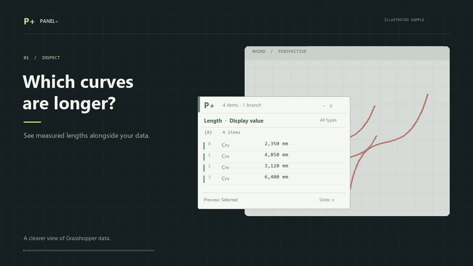
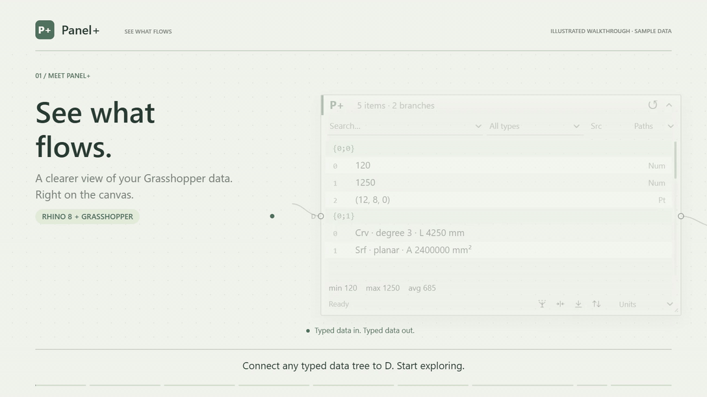
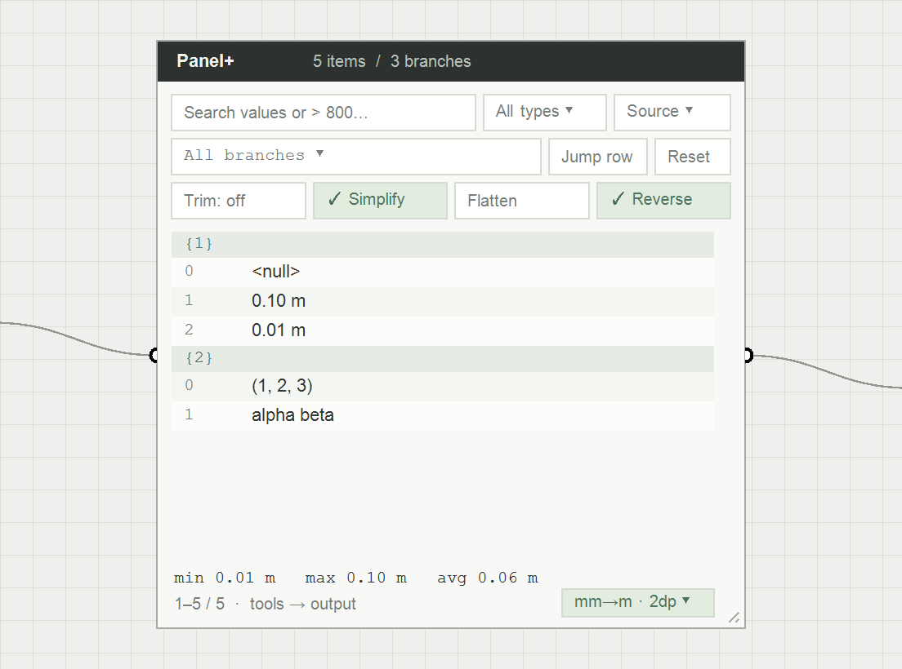

# Panel+

Created in [T3 Code](https://t3.codes).

**Panel+** (`panel-plus`) is a Grasshopper data inspector for Rhino 8 on Windows and Mac. Connect any data tree and see what flows: browse branches, measure geometry, search and filter, select rows to preview them in Rhino, and send exactly what you picked downstream.

[](docs/demo/panel-plus-short.mp4)

<sub>Illustrated sample data. [MP4 version](docs/demo/panel-plus-short.mp4).</sub>

## Install

Panel+ is published on Yak as **`panel-plus`** (beta). In Rhino 8, run `PackageManager`, tick **Include pre-releases**, search for `panel-plus` and install. Or close Rhino and run:

```text
yak install panel-plus 0.2.8-beta
```

If the earlier `better-gh-panel` package is installed, remove it first so the two copies don't both load. Find **Panel+** in **Params → Util** and connect a tree to **D**. Release notes for every version are on [GitHub Releases](https://github.com/tsoumdoa/better-gh-panel/releases).

## One-minute tour

[](docs/demo/panel-plus-demo.mp4)

<sub>Captioned, silent, illustrated sample data. [MP4](docs/demo/panel-plus-demo.mp4) · [日本語版 / Japanese](docs/demo/panel-plus-demo-ja.mp4) · run `npm run demo` for the editable animation ([source and recording notes](docs/demo/README.md)).</sub>

## What's new

**[`0.2.8-beta`](https://github.com/tsoumdoa/better-gh-panel/releases/tag/v0.2.8-beta)**

- **Controls that say what they do.** The search field starts with a mode chip (Text, Length, Vertex count, …) that opens the mode menu; the footer range ("1–15/40") opens Jump to row (also Ctrl/Cmd+G); the footer reads "D = input", "D: 2 filters", "D: tools" or "D: values", with a × beside it that clears the filters; the Trim icon shows its depth; Reset all (↺) sits in the footer beside the tools and Units it resets.
- **Menus that fit.** Dropdowns, Stats, Units and the row menu extend beyond the panel, flip away from the edge of the view, and draw above neighbouring components. Dropdowns page the choices beyond twelve rows; the row menu never pages and scrolls under the wheel when it is taller than the view.
- **Double-click a row to view its full value.** Esc or a double-click on empty list space clears the selection.
- **Clearer feedback.** Selected rows get an accent bar, the active Units chip is readable ("→m ↑0.25 2dp"), the Paths placeholder matches the other dropdowns, tooltips are shorter, every undo step is named "Panel+ …", and disabled text follows the dark canvas theme.
- **Behaviour changes:** double-clicking a row no longer clears the selection; Jump to row and Reset all moved from the header to the footer; the right-click menu is no longer paged.
- **Validated natively again.** All 24 Rhino fixtures run and pass; expectations left stale by the waived 0.2.6 and 0.2.7 validations were refreshed, and the harness can save review screenshots on request.

See [CHANGELOG](CHANGELOG.md) for earlier releases.

## Features



### Inspect

- **Typed rows grouped by branch.** Branch headings show their path and item count; rows show compact type labels (**Pt**, **Crv**, **Srf**, **Brep**, **Mesh**, **Num**, …), empty branches, `<empty>` text and geometry-group names with their object counts.
- **Geometry metrics, automatically.** Visible curves, surfaces, Breps and meshes are measured in the background — length, area, volume and shape hints such as **Srf · untrimmed · planar · A 100 mm²**. Rows show **measuring…** until ready, and Panel+ never moves the camera.
- **Invalid and unverified values are marked** with a label, a **!** or **?** badge and the reason in the tooltip.
- **Data checks.** A quiet, clickable **Check:** line flags null, invalid and unverified items and strong branch-length outliers before search filters; every warning segment is amber. Healthy trees use no extra space.
- **Counts and Stats.** The footer shows matched/total items and branches. **Stats** lists min/max/average plus every unique value with its frequency, using the presented numbers.
- **Long values** open in a read-only, scrollable **View full value** window when you double-click a row, or from its right-click menu.

### Search, filter and sort

Type in the search field: rows update as you type, **Enter** or clicking away applies the query and **Esc** restores the previous one. The mode chip at the start of the field (**Text ▾**, **Length ▾**, **List ▾**, …) picks what to match:

| Mode | Example |
| --- | --- |
| Text (values, paths, types) / regular expression | `facade`, `^A-0[1-4]` |
| Numeric value, Length, Area, Volume, X/Y/Z | `> 4000`, `<= 25`, `!= 0` |
| List length · per branch | `>= 3`, `= 0` |
| Input-specific properties (below) | `>= 2`, `>= 2026-01-01` |

Comparisons test the numbers shown, after unit conversion, factor rounding and any explicit decimal places. Automatic keeps full precision. Picking a comparison mode (numbers, dates, text properties) shows its values and opens the editor. Validity offers Valid/Invalid/Unverified/Null; Boolean properties offer True/False. **×** clears the expression and returns to Text mode; Undo restores both. Combine searches with the **Types** filter (including *invalid only*) and **Paths** (`0;2;4` or `{0;2;4}`, including descendants). **Asc/Desc** sorts within each branch and adds Excel-style row numbers; wire outputs always keep tree order.

**Behaviour changes:** Numbers now always use "." as the decimal separator, so saved text/regex filters written with "," need updating. Decimal places now also rounds numbers sent on D and S.

<details>
<summary>Selectable properties by input type</summary>

| Input | Properties |
| --- | --- |
| Curves, lines, arcs, circles | Degree, closed, shape and planar; polyline segment count; radius and arc angle |
| Breps / meshes | Face and vertex counts, closed; Brep edge count and solid; planarity for single-face Breps |
| Surfaces | Face count; trimmed, U/V degree and planar for single-face surfaces |
| Rectangles / boxes | Width, height; rectangle perimeter; box depth and surface area |
| Vectors / planes | Vector magnitude; plane origin and axis components |
| Groups | Name and direct object count |
| Colours / domains | R/G/B/alpha and named colour; domain endpoints |
| Text / Boolean / GUID / time | Text value and length; Boolean/GUID value; date-time and its parts |
| Complex numbers / transforms | Real, imaginary, magnitude, phase; determinant and matrix entries |
| SubD / extrusion / point cloud | Vertex/edge/face counts, solid/closed; extrusion height and profiles; point count |
| Text Dots | Text, character count, X/Y/Z, font size (screen pixels) and font face |
| Text entities / leaders / dimensions / centermarks | Text, character count, origin X/Y/Z; dimension length and angle |
| Hatches | Pattern index, scale, rotation and origin X/Y/Z |
| Culture / location / path / matrix | Culture name and English name; latitude/longitude (degrees); path depth; matrix row/column counts |
| Block instances / detail views | Block definition ID; detail projection, projection lock and page-to-model ratio |
| Every input | Data type, validity, branch path and zero-based item index |

Text Dots display their text and support coordinate filters, viewport preview and geometry copy.

Unsupported properties show `n/a`. Text comparisons are exact; quote text to keep surrounding spaces (`= " 001 "`).

</details>

### Reshape the tree

The footer's tree tools run in a fixed order — **Simplify → Trim → Flatten → Reverse** — then unit conversion, filters and **Create set**. An active Trim shows its depth as a small badge on its icon.

- **Create set** groups equal displayed values per branch (or across the tree with Flatten). Rows use set index **k**. **Out Items** sends all members in **{path;k}** branches (**{k}** when flattened); **Out Values** sends each unique value once at displayed precision. List-length sets group original branches as **{k;path}**. An occurrence badge such as **9×** lists every original path and index.
- **Units** converts numbers and geometry metrics (mm ↔ m, mm² ↔ m², mm³ ↔ m³, rad ↔ deg), sets **Decimal places**, and can **Round up by factor**. Unit conversion, Round up by factor, then explicit Decimal places define one presented number shared by the rows, Values output, clipboard, comparisons and Stats. Numeric Items also leave at this precision; geometry is never modified. Factors apply to plain numbers, geometry metrics, X/Y/Z and dimensional properties, including angles. Counts, indices, dates, colour channels, axis components and matrix entries ignore the factor; integer properties stay integers. With Round up by factor, Panel+ rounds each number's full-precision decimal form up to the factor, then Decimal places also rounds up. Inputs whose full-precision digits sit above a step (e.g. 0.1+0.2 = 0.30000000000000004) round up to the next step. Without a factor, decimal rounding remains half away from zero. Rounding uses the faithful 15-digit decimal form when possible, so 2.675 at 2 decimal places becomes 2.68, as in Excel. Hover a rounded row to see its raw value and rounding. When active, the Units chip reads compactly, for example **→m² ↑0.25 3dp** (target unit, factor, decimals), and widens to fit; its tooltip spells out the full setting.
- **Clear filters** clears search, mode, type, path, invalid-only, sorting, selection and scroll. Use the **×** on the footer's **D: 1 filter** chip or the component's right-click menu. When only sorting or a search mode is set, the chip names it instead (**Sorted ×**, **Length ×**, **Length · sorted ×**). One Undo restores the filters.
- **Reset all** (footer ↺, beside Units and set apart from the tree tools) also resets tree tools, units, rounding, decimals, Out Items | Values and B + F follow. It keeps Preview mode, item order, Table and size. One Undo restores the settings.

### Select, preview and copy

- **Click** a row to select it, **Ctrl/Cmd-click** to toggle, **Shift-click** for a range, a **branch heading** for the whole branch, and **Alt/Option-click** to pick the same item index in every branch. **Select all** takes every current match.
- **Preview** draws **Selection** (default), **Results**, or **Off**, in Grasshopper's selection colour. The header reads **Preview: Selection**, **Preview: Results** or **Preview: Off**. **Show item order** adds numbered dots in Rhino.
- **Branch addresses.** Hover a branch heading to copy its path with the small copy glyph. Right-click for path formats, selected paths or **Show only this branch**. Row menus offer **Copy address(es)** (`{path}(index)`; Create-set Items copy the D branch `{path;k}`, or `{k}` with Flatten) and **Copy as table**: Copy Path, Index and every visible column as a tab-separated table.
- **Right-click** a row to **Frame selection** in Rhino, **Copy value(s)**, **View full value**, or **Copy geometry for Rhino** (Windows) to paste with Rhino's normal Paste.

### Table

Use **Add column** in the component's right-click menu to append optional C1, C2, … inputs after F. Rename an input to title its column; **Remove column** removes an added input and its wires, and Undo restores both. Added columns are display-only: D, S, B, F and geometry preview keep their existing contracts.

Use **Add header input** for optional **Headers (H)**, or **Remove header input** to remove it. H is always the last input; new columns insert before it. Supply titles in tree order: D first, then F when shown, then each added column. Missing, null or blank titles keep that input’s nickname; extra titles are ignored. For example, `[Panel, Code, Area (m²), ""]` titles D, F and two columns, with the last keeping its nickname. Titles change headers and the TSV header row immediately, keeping metric/unit/sort marks and unwired/error states. Port names, outputs and sorting keys stay unchanged, and H alone does not enable the table. H and its wire save with the component; adding/removing H supports Undo.

Click **Table** in the header to show the columns beside D. It initially fits their content between the ordinary and doubled panel widths; subsequent resizing is yours. With no wired columns and Table off, the ordinary panel is unchanged. Hiding the table retains its wires. Old files with D|F enabled open as a D/F table.

- D and the row-number gutter stay frozen. Other columns share a horizontal scrollbar; Shift+wheel scrolls sideways while the panel has focus. There is one vertical scrollbar.
- Column titles follow H when supplied, otherwise input nicknames. Title changes do not rebuild the snapshot or query. Widths auto-fit the visible cells, grow while you scroll, and reset when the result or titles change; drag a header border to resize, or double-click it to restore auto-fit. Manual widths and the sorted column save with the input’s GUID and index, preserving them when components are copied. Removing the sorted column restores tree order.
- Every column pairs independently against D using F's rule: equal original branch counts, exact paths first, then remaining branches in tree order, with items paired by index. A mismatched column has an amber header and explanatory tooltip; other columns continue working.
- Missing cells are blank with a muted dash at the start of a run. Extra values appear after the D rows, muted beside blank D spacers, and are not selectable. **only in <column>** identifies extra tails; **paired with hidden D rows** identifies retained partners of filtered D rows. Each unequal column has an amber length badge in its branch heading: **9 of 10** for shorter columns or **+1 extra** for longer columns; its tooltip explains the two lengths.
- Click a column title for ascending → descending → tree order; right-click it for the three sort commands. The existing Asc/Desc control sorts by D. Sorting stays inside each branch and never changes wire outputs.
- Clicking any cell selects its D row with the existing gestures. Search, Types, Paths and comparison modes still apply to D. **Ctrl/Cmd+C** or **Copy as table**: Copy Path, Index and every visible column as a tab-separated table. List-length tables use the displayed branch number for Index. **Copy value** uses the clicked column; **Copy address(es)** uses D. Double-click a cell for its full raw value.
- Units, rounding factor and decimal places apply to number cells in every column for display and table copy. F output stays raw. Geometry cells show their background measurement; type and shape details are in the tooltip. A column with one primary metric kind shows right-aligned monospaced numbers, with a header such as **Edges · L · m**. Mixed metric kinds show compact cells such as **Crv L 4.20 m** or **Srf A 12.00 mm²**, with no metric or unit in the header. Text and null members retain their usual display and do not change the geometry metric kind. Visible D rows are measured first, then visible columns from left to right; scrolling sideways requests newly visible cells. Hidden tables do no column measurement work except for the active sort column. Geometry sorting prepares the whole column and compares its shown primary metric, with unavailable metrics last. Copy waits for measurements and never copies `measuring…`. Header units appear only when the conversion applies to that metric. As for D, **→m** converts lengths, **→m²** converts areas, and **→m³** converts volumes; other dimensions retain their model units. Table copy uses the compact shown text, so homogeneous cells copy the number only, with the metric/unit retained in the TSV header. Create set cells summarize the column values paired by index with that set’s members, using **—** for missing partners. Visible Create set and List length summaries join the compact member text with **·** (numbers only in homogeneous geometry columns), preserve missing **—** members, and use a short **… +N** suffix. They measure their bounded member previews and show **measuring…** until ready. The heading badge identifies extra items; only List length branch rows show a muted **+N only in <column>** note. F output retains its whole-branch expansion for unequal branches.

<details>
<summary>F output pairing details</summary>

F sends the F items paired with the D items that B + F follow, at D's transformed paths. Values and types are unchanged.

- Equal branches follow item membership; scoped unequal branches emit their whole F branch once per group.
- Empty D partners are included when D retains the branch, without item filters or Create set; path and list-length filters preserve them.
- Sets use {path;k} ({k} when flattened; {k;path} for list-length sets), in both output modes.
- F must have the same branch count as D; exact paths pair first, then remaining branches in tree order.

</details>

### Outputs

| Port | Output |
| --- | --- |
| **D** | Matching **Items** (default) or displayed **Values**, with explicit rounding as shown, in tree order. Automatic sends full precision; Create set Values sends compact displayed set values. Set Items: all members in one branch per value; set Values: one list of unique values per source branch. |
| **S** | Selected Items or Values. Selected sets include all members and retain D's group paths. Empty when nothing is selected. |
| **B** | A True/False mask in the original D tree shape, including every member of kept or selected sets. |
| **F** | F sends the F items paired with the D items that B + F follow, at D's transformed paths. Values and types are unchanged. |

**Out Items | Values** appears in the footer when showing values or creating a set; it is also in the component's right-click menu. With explicit decimals, the Values tooltip says "Sends the values exactly as shown." In Automatic with a factor it says "Sends the rounded values at full precision; rows may be abbreviated." Without a factor it says "Sends full-precision values; rows may be abbreviated." Sets say "Sends the displayed set values." The ports always read **D** and **S**. Numbers use the shown units and explicit rounding; Automatic keeps full wire precision except for compact displayed Create set Values; unavailable values output null to preserve row alignment. Older saved sets retain Values output.

The Out Items | Values switch resets to Items whenever hidden (for example, returning to Text with Create set off). Undo restores both settings.

Right-click the component → **B + F follow** to make B and F follow the **Results** (default) or only the **Selection**. Ports always read **D**, **S**, **B**, **F**; B/F tooltips state the current scope. With Items output and nothing filtered or transformed, D forwards its input unchanged.

### Layout

- Drag the dotted header grip to move the panel and the bottom-right corner to resize it. The header holds **Preview** (and **Table** when a column is wired or the table is on), the chevron that toggles **Full ↔ Half** height, and **–**, which minimizes the panel to a capsule that still shows counts. Wires stay connected throughout.
- The footer shows the visible range (**1–15/40**; on wide panels, the item and branch summary) and what D sends: **D = input**, **D: 1 filter**, **D: filtered**, **D: tools** or **D: values**. Click the range, or press **Ctrl/Cmd + G**, to jump to a row. With filters to clear, the D part is a chip whose **×** clears them; on narrow panels the chip takes priority over the range, and it hides only when a notice (such as **N selected** or **Recomputing…**) replaces the footer status. Selected rows carry a green bar at their left edge.
- On a dark Grasshopper canvas Panel+ uses a matching dark palette. Below 50% zoom it shows a large item/branch summary.

### Keyboard and mouse

Clicking inside the panel focuses it and keeps your selection; the first Esc clears the selection and the next releases focus. A green ring shows focus; without focus, keys and wheel go to Grasshopper as usual. Double-clicking a row opens its full value in one reusable window; double-clicking empty list space, Clear filters, Reset all and changes to the input's structure clear the selection. Menus may extend past the panel and draw above other components; near the edge of the view they open on the other side of their button. Clicking elsewhere on the canvas closes a menu and the click still reaches what you clicked, except that the second click of a double-click is absorbed.

| Key | Action |
| --- | --- |
| **↑ / ↓** (+ **Shift**) | Move (or extend) the selection |
| **PgUp / PgDn / Home / End** | Scroll |
| **Ctrl/Cmd + C** | Copy the selected values (Grasshopper objects when no rows are selected) |
| **Ctrl/Cmd + Shift + C** | Copy unique paths of selected rows, in tree order |
| **Ctrl/Cmd + A** | Select all rows |
| **Ctrl/Cmd + F** or **/** | Search |
| **Ctrl/Cmd + G** | Jump to a row |
| **Esc** | Clear the selection, then release focus |
| Mouse wheel | Scroll the rows or menu under the pointer; hold any modifier to zoom the canvas instead |

## Development

See [CONTRIBUTING.md](CONTRIBUTING.md) for development and validation.

## License

[MIT](LICENSE). The license is also included in locally generated Yak packages.
