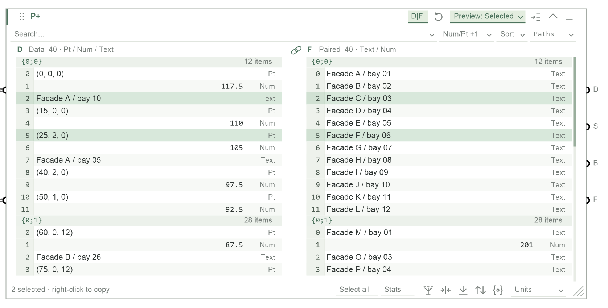
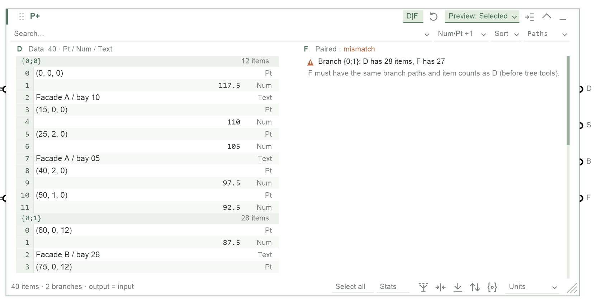

# Panel+

Created in [T3 Code](https://t3.codes).

**Panel+** (`panel-plus`) is a Grasshopper data inspector for Rhino 8 on Windows and Mac. Connect any data tree and see what flows: browse branches, measure geometry, search and filter, select rows to preview them in Rhino, and send exactly what you picked downstream.

[](docs/demo/panel-plus-short.mp4)

<sub>Illustrated sample data. [MP4 version](docs/demo/panel-plus-short.mp4).</sub>

## Install

Panel+ is published on Yak as **`panel-plus`** (beta). In Rhino 8, run `PackageManager`, tick **Include pre-releases**, search for `panel-plus` and install. Or close Rhino and run:

```text
yak install panel-plus 0.2.4-beta
```

If the earlier `better-gh-panel` package is installed, remove it first so the two copies don't both load. Find **Panel+** in **Params → Util** and connect a tree to **D**. Release notes for every version are on [GitHub Releases](https://github.com/tsoumdoa/better-gh-panel/releases).

## One-minute tour

[](docs/demo/panel-plus-demo.mp4)

<sub>Captioned, silent, illustrated sample data. [MP4](docs/demo/panel-plus-demo.mp4) · [日本語版 / Japanese](docs/demo/panel-plus-demo-ja.mp4) · run `npm run demo` for the editable animation ([source and recording notes](docs/demo/README.md)).</sub>

## What's new

**[`0.2.4-beta`](https://github.com/tsoumdoa/better-gh-panel/releases/tag/v0.2.4-beta)**

- **What you see is what you send.** Round up and Decimal places now apply to every number the panel shows, including Length, Area, Volume, properties and X/Y/Z. D and S send exactly those numbers, and filters and Stats use them too. Hover a rounded value to see the raw one.
- **D | F pairs by branch.** F only needs the same number of branches as D; item counts may differ. Missing and extra F items are marked in the pane.
- **Copy branch addresses.** Hover a branch heading to copy `{0;2;52}`, or right-click a row for `{0;2;52}(3)` or a table for Excel.
- **Data warnings.** A short strip flags nulls, invalid items and branches whose length differs from the rest; click it to filter to them.
- **Behaviour changes:** Decimal places now rounds what D and S send, and numbers always use `.` as the decimal separator.

**[`0.2.3-beta`](https://github.com/tsoumdoa/better-gh-panel/releases/tag/v0.2.3-beta)**

- **Send items or values.** When the panel shows a value (Length, Area, Validity, …) or a set, the new **Out Items | Values** switch next to **Select all** chooses what D and S send: the original data, for example the curves you filtered by length, or the values you see.
- **One branch per set value.** With Create set and **Items**, every matching item goes to `{path;k}`, and set rows are numbered by that **k**. Selecting a set row sends, previews and frames all of its members.

**[`0.2.2-beta`](https://github.com/tsoumdoa/better-gh-panel/releases/tag/v0.2.2-beta)**

- **Pick a property to see it.** Choosing Area, Validity, Closed, … in the filter dropdown shows its value in every row; click the search field to filter by it.
- **Pick values from a list.** Validity offers **Valid · Invalid · Unverified · Null** and true/false properties offer **True · False**, applied in one click instead of typed.

## Features


### Inspect

- **Typed rows grouped by branch.** Branch headings show their path and item count; rows show compact type labels (**Pt**, **Crv**, **Srf**, **Brep**, **Mesh**, **Num**, …), empty branches, `<empty>` text and geometry-group names with their object counts.
- **Geometry metrics, automatically.** Visible curves, surfaces, Breps and meshes are measured in the background — length, area, volume and shape hints such as **Srf · untrimmed · planar · A 100 mm²**. Rows show **measuring…** until ready, and Panel+ never moves the camera.
- **Invalid and unverified values are marked** with a label, a **!** or **?** badge and the reason in the tooltip.
- **Data checks.** A quiet, clickable **Check:** line flags null, invalid and unverified items and strong branch-length outliers before search filters; outlier counts turn amber. Healthy trees use no extra space.
- **Counts and Stats.** The footer shows matched/total items and branches. **Stats** lists min/max/average plus every unique value with its frequency, using the presented numbers.
- **Long values** open in a read-only, scrollable **View full value** window from the row's right-click menu.

### Search, filter and sort

Type in the search field: rows update as you type, **Enter** applies the query and **Esc** restores the previous one. The search dropdown picks what to match:

| Mode | Example |
| --- | --- |
| Text (values, paths, types) / regular expression | `facade`, `^A-0[1-4]` |
| Numeric value, Length, Area, Volume, X/Y/Z | `> 4000`, `<= 25`, `!= 0` |
| List length · per branch | `>= 3`, `= 0` |
| Input-specific properties (below) | `>= 2`, `>= 2026-01-01` |

Comparisons test the numbers shown, after unit conversion, factor rounding and any explicit decimal places. Automatic keeps full precision. Pick a comparison mode to show its values, then click the search field to filter. Validity offers Valid/Invalid/Unverified/Null; Boolean properties offer True/False. **×** clears the filter, then the values. Combine searches with the **Types** filter (including *invalid only*) and **Paths** (`0;2;4` or `{0;2;4}`, including descendants). **Asc/Desc** sorts within each branch and adds Excel-style row numbers; wire outputs always keep tree order.

**Behaviour changes:** Numbers now always use "." as the decimal separator, so saved text/regex filters written with "," need updating. Decimal places now also rounds numbers sent on D and S.

<details>
<summary>Selectable properties by input type</summary>

| Input | Properties |
| --- | --- |
| Curves, lines, arcs, circles | Degree, closed, shape and planar; polyline segment count; radius and arc angle |
| Breps / meshes | Face and vertex counts, closed; Brep edge count and solid; planarity for single-face Breps |
| Surfaces | Face count; trimmed, U/V degree and planar for single-face surfaces |
| Rectangles / boxes | Width, height; rectangle perimeter; box depth and surface area |
| Vectors / planes | Vector magnitude; plane origin and axis components |
| Groups | Name and direct object count |
| Colours / domains | R/G/B/alpha and named colour; domain endpoints |
| Text / Boolean / GUID / time | Text value and length; Boolean/GUID value; date-time and its parts |
| Complex numbers / transforms | Real, imaginary, magnitude, phase; determinant and matrix entries |
| SubD / extrusion / point cloud | Vertex/edge/face counts, solid/closed; extrusion height and profiles; point count |
| Text Dots | Text, character count, location X/Y/Z, font height (screen pixels) and font face |
| Text entities / leaders / dimensions / centermarks | Stored plain text, character count, plane location X/Y/Z and text height (model units); dimension value (radians for angular dimensions) |
| Hatches | Pattern index, scale, rotation (radians) and plane location X/Y/Z |
| Culture / location / path / matrix | Culture name and English name; latitude/longitude (degrees); path depth; matrix row/column counts |
| Block instances / detail views | Block definition ID; detail projection type, projection lock and page-to-model ratio |
| Every input | Data type, validity, branch path and zero-based item index |

Text Dots show their text and location, preview/highlight in Rhino, frame, and copy as Rhino geometry. Annotation, hatch, block and detail properties describe the captured native shape; separate Grasshopper model styles, hatch patterns and block definitions are not resolved. Their automatic preview/frame/geometry copy remains unavailable. These types retain typed Items output; Values output can emit their selected properties. Matrix capture is limited to 4,096 cells and paths to 4,096 indices. Culture properties describe its identity, not custom formatting. Material and Field rows show their material kind or element count and remain unverified.

Unsupported properties show `n/a`. Text comparisons are exact; quote text to keep surrounding spaces (`= " 001 "`).

</details>

### Reshape the tree

The footer's tree tools run in a fixed order — **Simplify → Trim → Flatten → Reverse** — then unit conversion, filters and **Create set**:

- **Create set** groups equal displayed values per branch (or across the tree with Flatten). Rows use set index **k**. **Out Items** sends all members in **{path;k}** branches (**{k}** when flattened); **Out Values** sends each unique value once at displayed precision. List-length sets group original branches as **{k;path}**. An occurrence badge such as **9×** lists every original path and index.
- **Units** converts numbers and geometry metrics (mm ↔ m, mm² ↔ m², mm³ ↔ m³, rad ↔ deg), sets **Decimal places**, and can **Round up by factor**. Unit conversion, Round up by factor, then explicit Decimal places define one presented number shared by the rows, Values output, clipboard, comparisons and Stats. Numeric Items also leave at this precision; geometry is never modified. Factors apply to plain numbers, geometry metrics, X/Y/Z and dimensional properties, including angles. Counts, indices, dates, colour channels, axis components and matrix entries ignore the factor; integer properties stay integers. Rounding uses the faithful 15-digit decimal form when possible, so 2.675 at 2 decimal places becomes 2.68, as in Excel. Hover a rounded row to see its raw value and rounding.
- **Reset** returns to the incoming data in one click; one Undo restores your settings.

### Select, preview and copy

- **Click** a row to select it, **Ctrl/Cmd-click** to toggle, **Shift-click** for a range, a **branch heading** for the whole branch, and **Alt/Option-click** to pick the same item index in every branch. **Select all** takes every current match.
- **Preview** draws **Selected** rows (default), all **Filtered results**, or nothing, in Grasshopper's selection colour. **Show item order** adds numbered dots in Rhino.
- **Branch addresses.** Hover a branch heading to copy its path with the small copy glyph. Right-click for path formats, selected paths or **Show only this branch**. Row menus offer **Copy address(es)** (`{path}(index)`; Create-set Items copy the D branch `{path;k}`, or `{k}` with Flatten) and **Copy as table** (Path, Index, shown Value as TSV).
- **Right-click** a row to **Frame selection** in Rhino, **Copy value(s)**, **View full value**, or **Copy geometry for Rhino** (Windows) to paste with Rhino's normal Paste.

### D | F split view

Connect matching data to the optional **F** input and click **D|F** in the header. The panel doubles in width and shows F's values beside D, row for row, through the same tree tools, filters, sorting and selection — for example, which named facade panels passed a length filter.



- **Linked scrolling** (the chain link between the pane captions) moves both panes with one scrollbar. Unlink it to scroll each pane on its own; selecting a row brings its partner into view, and relinking snaps F back to D.
- Copying and **View full value** from the F pane use F's raw values, unconverted. F row addresses and tables use F's own original path and index. Heading **Copy path** copies the clicked pane's path, including F's own path for order-paired branches. Hover copy glyphs follow the complete drawn label and disappear when it is clipped. Data warnings mark D headings; F keeps its pairing badge and counts.
- F must have **the same number of branches as D**, before tree tools. All identical paths pair first; remaining branches pair in tree order. The F heading shows its own path when paired by order.
- Items pair by index within each original branch pair. Missing F cells stay empty, with a label on the first row of each run; additional F items appear as muted rows beside blank D spacers. Only indices beyond the original D branch length are labelled **only in F**; retained values whose D rows are hidden carry **paired with hidden D rows**. These muted rows are not selectable. Every F item keeps its original F index, including after Reverse, filtering and sorting. An amber **D 12** badge beside F's count marks unequal lengths; filtered F headings show the matching count, such as **3 of 12 items**.
- With **Create set**, each item or list-length set has one F cell: a bounded, single-line summary of exactly the values F emits for that group, in output order (for example, `f0 · f1 · f2 · f3 … +7 in this set`). Sets have no hidden-partner or only-in-F notes. Selecting an F set cell scopes its complete group; copying it includes every emitted F value. Use **Ctrl+C** on a selected F list-length set to copy the group.
- When branch counts differ, the F pane explains the mismatch:



The **D|F** chip is hidden until F has data. Split view saves with the definition and supports Undo.

### Outputs

| Port | Output |
| --- | --- |
| **D** | Matching **Items** (default) or displayed **Values**, with the same rounding as shown, in tree order. Set Items: all members in one branch per value; set Values: one list of unique values per source branch. |
| **S** | Selected Items or Values. Selected sets include all members and retain D's group paths. Empty when nothing is selected. |
| **B** | A True/False mask in the original D tree shape, including every member of kept or selected sets. |
| **F** | Raw paired items at D's transformed paths: equal branches follow item membership; an unequal branch emits its whole F branch once per destination group when any D member is in scope. An empty D branch's F partner is included when D retains that branch, no item filter is active, and Create set is off (item or list-length). Item filters follow the query engine's rule: text/regex or value/property comparisons, type and invalid-only restrictions exclude it; path and list-length restrictions retain it when D still shows the branch. It follows D's destination even after merging or Flatten. Otherwise it is neither emitted nor shown, and is excluded from F heading totals. Sets use the same group paths as set Items in both output modes. |

**Out Items | Values** appears in the footer when showing values or creating a set; it is also in the component's right-click menu. With explicit decimals or a factor, the Values tooltip says "Sends the values exactly as shown"; in Automatic it says "Sends full-precision values; the display may be abbreviated"; the ports always read **D** and **S**. Numbers use the shown units and explicit rounding; Automatic keeps full wire precision except for compact displayed Create set Values; unavailable values output null to preserve row alignment. Older saved sets retain Values output.

Right-click the component → **B + F source** to make B and F follow the **Filtered results** (default) or only the **Selected rows**. In Selected mode the port labels read **B·S** and **F·S**. With Items output and nothing filtered or transformed, D forwards its input unchanged.

### Layout

- Drag the dotted header grip to move the panel and the bottom-right corner to resize it. The header chevron toggles **Full ↔ Half** height; **–** minimizes it to a capsule that still shows counts. Wires stay connected throughout.
- On a dark Grasshopper canvas Panel+ uses a matching dark palette. Below 50% zoom it shows a large item/branch summary.

### Keyboard and mouse

Click inside the panel to focus it (a green ring appears). Without focus, every key and wheel event goes to Grasshopper as usual.

| Key | Action |
| --- | --- |
| **↑ / ↓** (+ **Shift**) | Move (or extend) the selection |
| **PgUp / PgDn / Home / End** | Scroll |
| **Ctrl/Cmd + C** | Copy the selected values (Grasshopper objects when no rows are selected) |
| **Ctrl/Cmd + Shift + C** | Copy unique paths of selected rows, in tree order |
| **Ctrl/Cmd + A** | Select all rows |
| **Ctrl/Cmd + F** or **/** | Search |
| **Esc** | Clear the selection, then release focus |
| Mouse wheel | Scroll the rows or menu under the pointer; hold any modifier to zoom the canvas instead |

## Development

```text
npm run check
```

Runs the core tests, native coordinator and packaging checks, builds and stages both Rhino runtimes, and verifies there is no unused code or non-UTF-8 C# source. It doesn't launch Rhino. Run it before opening or merging a PR; GitHub Actions CI is disabled.

To build a Yak package, run `dotnet build BetterGhPanel.sln -c Release` then `node scripts/package.mjs`. During development, run affected native Rhino regressions with `tests/BetterGhPanel.RhinoSmoke/run.ps1 -Fixture ui-ux,row-selection` (choose names from `fixtures.json`). Run the full inventory for broad runtime changes and releases; launcher self-tests run separately. See the [validation instructions](docs/maintainability.md#validation) for commands and optional diagnostics. See also:

- [Build, packaging and release validation](docs/packaging.md)
- [Current architecture](docs/current-architecture.md) and [maintainability guide](docs/maintainability.md)
- [Geometry measurement](docs/geometry-measurement-safety.md) and [preview](docs/geometry-preview-safety.md) safety

The original interactive HTML design study is preserved in `prototype/` (`npm start`, then <http://localhost:5173>); it uses generated data and is a visual reference only.

## License

[MIT](LICENSE). The license is also included in locally generated Yak packages.
