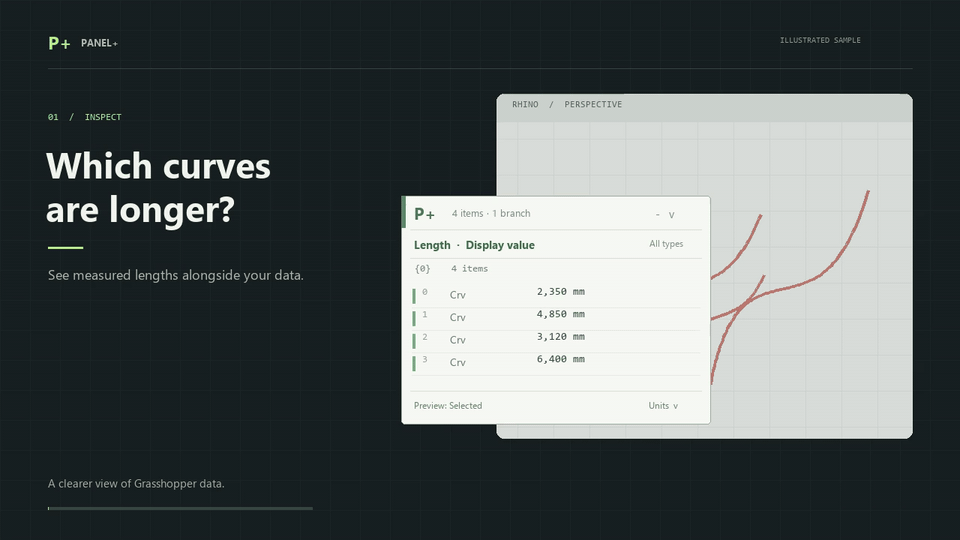
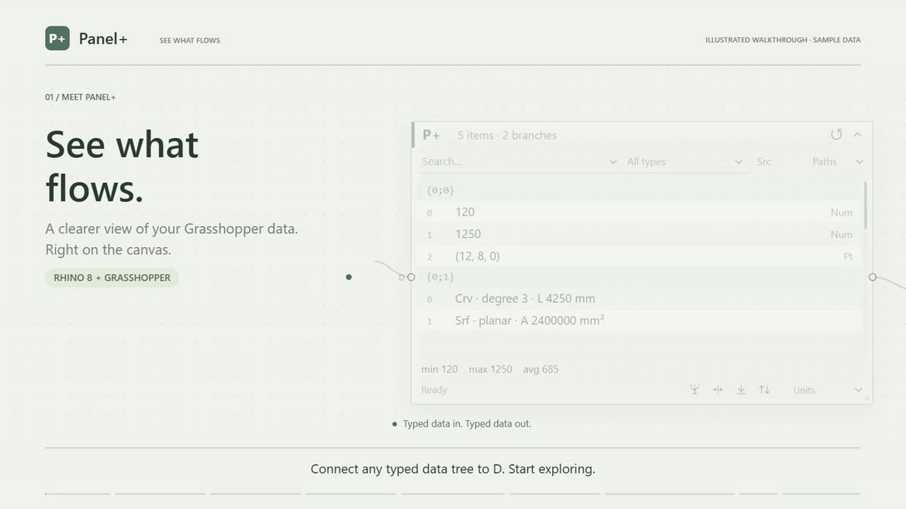
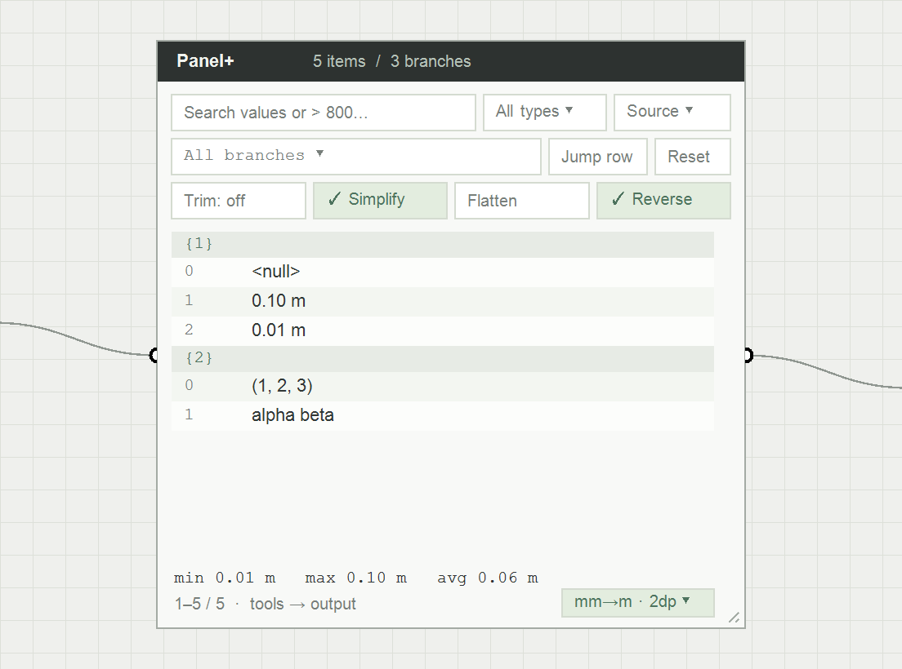

# Panel+

Created in [T3 Code](https://t3.codes).

**Panel+** (`panel-plus`) is a Grasshopper data inspector for Rhino 8 on Windows and Mac. Connect any data tree and see what flows: browse branches, measure geometry, search and filter, select rows to preview them in Rhino, and send exactly what you picked downstream.

[](docs/demo/panel-plus-short.mp4)

<sub>Illustrated sample data. [MP4 version](docs/demo/panel-plus-short.mp4).</sub>

## Install

Panel+ is published on Yak as **`panel-plus`** (beta). In Rhino 8, run `PackageManager`, tick **Include pre-releases**, search for `panel-plus` and install. Or close Rhino and run:

```text
yak install panel-plus 0.6.4-beta
```

If the earlier `better-gh-panel` package is installed, remove it first so the two copies don't both load. Find **Panel+** in **Params → Util** and connect a tree to **D**. Release notes for every version are on [GitHub Releases](https://github.com/tsoumdoa/better-gh-panel/releases).

## One-minute tour

[](docs/demo/panel-plus-demo.mp4)

<sub>Captioned, silent, illustrated sample data. [MP4](docs/demo/panel-plus-demo.mp4) · [日本語版 / Japanese](docs/demo/panel-plus-demo-ja.mp4) · run `npm run demo` for the editable animation ([source and recording notes](docs/demo/README.md)).</sub>

## What's new

**[`0.6.4-beta`](https://github.com/tsoumdoa/better-gh-panel/releases/tag/v0.6.4-beta)**

- **Search in D / F.** The Search mode menu can test D or its paired F input. With F picked, D's rows and geometry follow F's matches. F offers the same modes as D, including its own geometry properties; Types and Paths still filter D.
- **Viewport values from F.** Show values can label D, F or both (`Wall · 4.20 m`). Colour by value can use F: numbers use the palette, and text gets category colours with counts in the legend.
- **Pass / Fail preview.** Matching items keep their value colour (green when colouring is off) and failures draw red, with pass and fail counts in the legend.
- **Group by F.** Create set and Σ can group D items by their F value.
- **Clean** (first tree tool) removes empty branches from the rows and D. Nulls stay, and B keeps the original shape.
- **Show all dots** (Preview menu) keeps full text on every dot, even behind objects or overlapping. The preview limit and memory cap still apply.
- **Validation.** The Core tests cover these features. The automated Rhino fixtures could not run, and these features have not yet been tried in a live Rhino session.

See [CHANGELOG](CHANGELOG.md) for earlier releases.

## Features



### Inspect

- **Typed rows grouped by branch.** Branch headings show their path and item count; rows show compact type labels (**Pt**, **Crv**, **Srf**, **Brep**, **Mesh**, **Num**, …), empty branches, `<empty>` text and geometry-group names with their object counts.
- **Geometry metrics, automatically.** Visible curves, surfaces, Breps and meshes are measured in the background — length, area, volume and shape hints such as **Srf · untrimmed · planar · A 100 mm²**. Rows show **measuring…** until ready, and Panel+ never moves the camera.
- **Invalid and unverified values are marked** with a label, a **!** or **?** badge and the reason in the tooltip.
- **Data checks.** A quiet, clickable **Check:** line flags null, invalid and unverified items and strong branch-length outliers before search filters; every warning segment is amber. Healthy trees use no extra space.
- **Counts and Stats.** The footer shows matched/total items and branches. **Σ** replaces each branch’s rows with chosen stats and sends those numbers to D.
- **Long values** open in a read-only, scrollable **View full value** window when you double-click a row, or from its right-click menu.

### Search, filter and sort

Type in the search field: rows update as you type, **Enter** or clicking away applies the query and **Esc** restores the previous one. The mode chip at the start of the field (**Text ▾**, **Length ▾**, **List ▾**, …) picks what to match:

| Mode | Example |
| --- | --- |
| Text (values, paths, types) / regular expression | `facade`, `^A-0[1-4]` |
| Numeric value, Length, Area, Volume, X/Y/Z | `> 4000`, `<= 25`, `!= 0` |
| List length · per branch | `>= 3`, `= 0` |
| Input-specific properties (below) | `>= 2`, `>= 2026-01-01` |

With **F** connected, use **Search in** at the top of the mode menu to search either column. The switch uses the column titles from H or the input nicknames. Searching F tests the value paired with each D row and keeps the matching D items. Rows without a partner fail the search, and F is unavailable when it is unwired or the branch counts differ. Panel+ keeps F selected and shows the reason in amber. Choose D in the mode menu or reconnect F to continue. F offers the same modes, including properties of its own input and the length of the paired F branch. **Types** and **Paths** still apply to D. Switching inputs keeps the expression and uses Text if the current mode is unavailable. In Table, an underline identifies the column being searched.

With Table hidden, **Show values · no filter** on F adds the paired value beside each D row, for example `F 2.50 m`. Copying the row still copies its D value.

Comparisons test the numbers shown after unit conversion, factor rounding and any explicit decimal places. The formula applies to D only. Automatic keeps full precision. Picking a comparison mode (numbers, dates, text properties) shows its values and opens the editor. Validity offers Valid/Invalid/Unverified/Null; Boolean properties offer True/False. **×** clears the expression and returns to Text mode; Undo restores both. Combine searches with the **Types** filter (including *invalid only*) and **Paths** (`0;2;4` or `{0;2;4}`, including descendants). **Asc/Desc** sorts within each branch and adds Excel-style row numbers; wire outputs always keep tree order.

**Behaviour changes:** Numbers now always use "." as the decimal separator, so saved text/regex filters written with "," need updating. Decimal places now also rounds numbers sent on D and S.

<details>
<summary>Selectable properties by input type</summary>

| Input | Properties |
| --- | --- |
| Curves, lines, arcs, circles | Degree, closed, shape and planar; polyline segment count; radius and arc angle |
| Breps / meshes | Face and vertex counts, closed; Brep edge count and solid; planarity for single-face Breps |
| Surfaces | Face count; trimmed, U/V degree and planar for single-face surfaces |
| Rectangles / boxes | Width, height; rectangle perimeter; box depth and surface area |
| Vectors / planes | Vector magnitude; plane origin and axis components |
| Groups | Name and direct object count |
| Colours / domains | R/G/B/alpha and named colour; domain endpoints |
| Text / Boolean / GUID / time | Text value and length; Boolean/GUID value; date-time and its parts |
| Complex numbers / transforms | Real, imaginary, magnitude, phase; determinant and matrix entries |
| SubD / extrusion / point cloud | Vertex/edge/face counts, solid/closed; extrusion height and profiles; point count |
| Text Dots | Text, character count, X/Y/Z, font size (screen pixels) and font face |
| Text entities / leaders / dimensions / centermarks | Text, character count, origin X/Y/Z; dimension length and angle |
| Hatches | Pattern index, scale, rotation and origin X/Y/Z |
| Culture / location / path / matrix | Culture name and English name; latitude/longitude (degrees); path depth; matrix row/column counts |
| Block instances / detail views | Block definition ID; detail projection, projection lock and page-to-model ratio |
| Every input | Data type, validity, branch path and zero-based item index |

Text Dots display their text and support coordinate filters, viewport preview and geometry copy.

Unsupported properties show `n/a`. Text comparisons are exact; quote text to keep surrounding spaces (`= " 001 "`).

</details>

### Reshape the tree

The footer's tree tools run in a fixed order — **Clean → Simplify → Trim → Flatten → Reverse** — then units, formula and rounding, filters, and **Create set** or **Σ**. An active Trim shows its depth as a small badge on its icon.

- **Clean** removes empty input branches from the rows and from D. Null items stay, B keeps the original tree shape, and F follows the remaining D paths. The footer counts the empty branches Clean removed. Panel+ pairs D and F before Clean, so the original branch counts must match.
- **Create set** groups equal displayed values per branch (or across the tree with Flatten). Rows use set index **k**. **Out Items** sends all members in **{path;k}** branches (**{k}** when flattened); **Out Values** sends each unique value once at displayed precision. List-length sets group original branches as **{k;path}**. An occurrence badge such as **9×** lists every original path and index.
- With F connected, choose **Group by · F value** in Create set. The F cell shows the key and its occurrence count, and the D cell summarizes the members. Sort on F to order groups by their key, or on D to order them by their first member. A shared D geometry metric appears in the header, with compact numbers in the cells. **Out Values** sends one key per group at **{path;k}**, or **{k}** with Flatten. D rows without a partner form a separate group with a null key.
- **Σ** replaces each branch's rows with its stats, and D sends exactly those numbers per branch. Tick the stats in its picker; they always appear in this order: Count, Sum, Avg, Median, Min, Max, Range, Std dev (population). Add **Flatten** for stats across all branches.
  - With F connected, choose **Stats per · F value** for one heading and one output branch per key. Each group uses D's shown numbers and the same group paths as Create set by F. Extra F items without a D partner are skipped.
  - Stats use each row's shown number after filters: the Search value with Show values on, otherwise the row's own number or main metric. Automatic uses the displayed precision.
  - Text, null, invalid and unverified items are skipped, and the heading says **N skipped**. A branch that mixes kinds (for example lengths with areas, or plain numbers with lengths) shows **mixed L / A** and no stats; choose one numeric Search mode. Branches with no numbers give Count 0 and null for the other stats, so every branch keeps the same length.
  - Click Min or Max to select the item it came from. S sends the selected Min/Max values; B and F keep their usual scope over the source items.
  - In the table, each column shows the same stats for its own numbers (formula stays D-only). Ctrl+C copies the selected stats, or all stats as TSV when nothing is selected.
  - Σ and Create set turn each other off. Σ saves with the file and supports Undo; **D: stats ×** and Reset all turn it off.
- **Units** converts numbers and geometry metrics (mm ↔ m, mm² ↔ m², mm³ ↔ m³, rad ↔ deg), applies a **Formula…** in `x` (for example `x*2` or `x-50`), sets **Decimal places**, and can **Round up by factor**. The order is conversion → formula → Round up by factor → Decimal places. With Round up by factor, Panel+ rounds each number's full-precision decimal form up to the factor, then Decimal places also rounds up. Inputs whose full-precision digits sit above a step (e.g. 0.1+0.2 = 0.30000000000000004) round up to the next step. Without a factor, decimal rounding remains half away from zero. Rounding uses the faithful 15-digit decimal form when possible, so 2.675 at 2 decimal places becomes 2.68, as in Excel. Hover a rounded row to see its raw value and rounding. When active, the Units chip reads compactly, for example **→m² ↑0.25 3dp** (target unit, factor, decimals), and widens to fit; its tooltip spells out the full setting.
- **Formula…** uses the converted number before rounding as `x`. The preview updates while typing; wire outputs wait for Enter or clicking away. Esc or Cancel restores the previous formula and selection. Invalid drafts keep the last valid rows. Use `+ - * / ^`, parentheses, `pi`, `abs`, `sqrt`, `floor`, `ceil`, `min` or `max`; `*2` expands to `x*2`, and `-50` to `x-50`. Signed expressions such as `-x^2` keep their usual meaning, `-(x^2)`. Keep units out of the formula. Negative results are allowed; non-finite results show **unavailable**. Formula is saved with the component and supports Undo. **Formula: off** or `x` clears it.
- **Clear filters** clears search, mode, type, path, invalid-only, sorting, selection and scroll, and returns Search in to D. Use the **×** on the footer's **D: 1 filter** chip or the component's right-click menu. When only sorting or a search mode is set, the chip names it instead (**Sorted ×**, **Length ×**, **Length · sorted ×**). One Undo restores the filters.
- **Reset all** (footer ↺, beside Units and set apart from the tree tools) also turns Σ off and resets tree tools, units, formula, rounding, decimals, Out Items | Values and B + F follow. It keeps Preview settings, Table and size. One Undo restores the settings.

### Select, preview and copy

- **Click** a row to select it, **Ctrl/Cmd-click** to toggle, **Shift-click** for a range, a **branch heading** for the whole branch, and **Alt/Option-click** to pick the same item index in every branch. **Select all** takes every current match.
- **Preview** chooses **Selection** (default), **Results**, **Match / No match** or **Off**. Matches keep their value colour (green when colouring is off). Choose red, grey (default) or ghosted for other items. Ghosted geometry is see-through, with dots only for selected items. The legend counts every item after the tree tools and shows percentages. When **B + F follow** is set to **Results**, use **B** with Grasshopper's Dispatch to send the two groups downstream.
- **Show values** offers **Off**, **D value**, **F value** and **F · D** when F is wired or the saved source uses F. If F is unavailable, its choices are greyed out and the saved source stays selected. When F is unwired and the source is **D value** or **Off**, the control toggles D labels in one click. A combined label reads `Wall · 4.20 m`. **Show item order** adds the index first, as in `2 · Wall · 4.20 m`. D uses its numeric Search value or usual measurement. Circles show radius in other Search modes. Values use the same units and rounding as the rows, and pending measurements show `…`.
- **Dot placement** chooses **Centre**, **Box top** or **Box bottom**. Curves label a point on the curve. Closed solids and meshes keep their centre. Open surfaces stay on the material. By default, crowded dots can shrink, become small colour dots or share one label for nearby equal values.
- **Show all dots** is off by default. Turn it on to keep every preview dot at full text size, even behind objects or overlapping. Selected dots draw on top. **Hide dots behind objects** is disabled while **Show all dots** is on and returns to its previous setting when you turn it off. The preview limit and memory cap still apply.
- **Colour by value** can use **D value** or **F value**. **Viridis**, **Heat**, **Blue–white–red** and **Reverse** set the numeric colours across all Results. For F text, selecting **F value** turns on **Categories**. The first ten distinct values in the current row order get colours. The legend counts the items admitted to preview and shows one grey row for other categories. Values and colouring start off. Preview settings save with the file, support Undo and survive **Reset all**.
- **Branch addresses.** Hover a branch heading to copy its path with the small copy glyph. Right-click for path formats, selected paths or **Show only this branch**. Row menus offer **Copy address(es)** (`{path}(index)`; Create-set Items copy the D branch `{path;k}`, or `{k}` with Flatten) and **Copy as table**: Copy Path, Index and every visible column as a tab-separated table.
- **Right-click** a row to **Frame selection** in Rhino, **Copy value(s)**, **View full value**, or **Copy geometry for Rhino** (Windows) to paste with Rhino's normal Paste.

### Table

Use **Add column** in the component's right-click menu to append optional C1, C2, … inputs after F. Rename an input to title its column; **Remove column** removes an added input and its wires, and Undo restores both. A formula applies to **D only**. Its header shows **ƒ** when a committed formula applies to its rows. F and added columns keep units and rounding without the formula. Added columns are display-only: D, S, B, F and geometry preview keep their existing contracts.

Toggle **Column titles input** in the component's right-click menu to add or remove optional **Column titles (H)**. H is always last; new columns insert before it. Supply titles in tree order with fixed slots: item 0 titles D, item 1 titles F, and items 2+ title each added column. F's slot stays reserved when F is unwired or hidden. Missing, null or blank titles keep that input’s nickname; extra titles are ignored. For example, `[Panel, Code, Area (m²), ""]` titles D, F and two columns, with the last keeping its nickname. Headers, tooltips, sort labels, notes and TSV share the titles while metric/unit/sort marks and unwired/error states remain. Port names, outputs and sorting keys stay unchanged, and H alone does not enable the table. H and its wire save with the component and support Undo. Title changes use a normal solve.

Click **Table** in the header to show the columns beside D. It initially fits their content between the ordinary and doubled panel widths; subsequent resizing is yours. With no wired columns and Table off, the ordinary panel is unchanged. Hiding the table retains its wires. Old files with D|F enabled open as a D/F table.

- D and the row-number gutter stay frozen. Other columns share a horizontal scrollbar; Shift+wheel scrolls sideways while the panel has focus. There is one vertical scrollbar.
- Column titles follow H when supplied, otherwise input nicknames. Widths auto-fit the visible cells, grow while you scroll, and reset when the result or titles change; drag a header border to resize, or double-click it to restore auto-fit. Manual widths and the sorted column save with the input’s GUID and index, preserving them when components are copied. Removing the sorted column restores tree order.
- Every column pairs independently against D using F's rule: equal original branch counts, exact paths first, then remaining branches in tree order, with items paired by index. A mismatched column has an amber header and explanatory tooltip; other columns continue working.
- Missing cells are blank with a muted dash at the start of a run. Extra values appear after the D rows, muted beside blank D spacers, and are not selectable. **only in <column>** identifies extra tails, which are hidden while an item filter narrows D. Each unequal column has an amber length badge in its branch heading: **9 of 10** for shorter columns or **+1 extra** for longer columns; its tooltip explains the two lengths.
- Click a column title for ascending → descending → tree order; right-click it for the three sort commands. The existing Asc/Desc control sorts by D. Sorting stays inside each branch and never changes wire outputs.
- Clicking any cell selects its D row with the existing gestures. Search can use D or F, while Types and Paths use D. **Ctrl/Cmd+C** or **Copy as table** copies Path, Index and every visible column as a tab-separated table. D list-length tables use the displayed branch number for Index. **Copy value** uses the clicked column, and **Copy address(es)** uses D. Double-click a cell for its full raw value.
- Units, rounding factor and decimal places apply to number cells in every column for display and table copy. F output stays raw. Geometry cells show their background measurement; type and shape details are in the tooltip. A column with one primary metric kind shows right-aligned monospaced numbers, with a header such as **Edges · L · m**. With Units off it retains the model unit, e.g. **Edges · L · mm**; an area under **→m** keeps **A · mm²**. Mixed metric kinds show compact cells such as **Crv L 4.20 m** or **Srf A 12.00 mm²**, with no metric or unit in the header. Text and null members retain their usual display and do not change the geometry metric kind. Visible D rows are measured first, then visible columns from left to right; scrolling sideways requests newly visible cells. Hidden tables still measure the active sort column and F when it supplies search, groups or preview. Geometry sorting prepares the whole column and compares its shown primary metric, with unavailable metrics last. Copy waits for measurements and never copies `measuring…`. Single-metric headers always carry their measurement unit; counts never do. As for D, **→m** converts lengths, **→m²** converts areas, and **→m³** converts volumes; other dimensions retain their model units. Table copy uses the compact shown text, so homogeneous cells copy the number only, with the metric/unit retained in the TSV header. Create set cells summarize the column values paired by index with that set’s members, using **—** for missing partners. Visible Create set and List length summaries join the compact member text with **·** (numbers only in homogeneous geometry columns), preserve missing **—** members, and use the same **… +N in this set** or **… +N items** suffix as other columns. They measure their bounded member previews and show **measuring…** until ready. The heading badge identifies extra items; only List length branch rows show a muted **+N only in <column>** note.

<details>
<summary>F output pairing details</summary>

F sends the F items paired with the D items that B + F follow, at D's transformed paths. Values and types are unchanged.

- F follows B item by item, including on unequal branches: each D item marked True sends its F partner, if it has one.
- F items beyond D's length have no B entry. They are sent only when no item filter, Create set or selection narrows D.
- Empty D partners are included when D retains the branch, without item filters or Create set; path and list-length filters preserve them.
- Sets use {path;k} ({k} when flattened; {k;path} for list-length sets), in both output modes.
- When Σ groups by F, F follows the same group paths with the raw partners.
- F must have the same branch count as D; exact paths pair first, then remaining branches in tree order.

</details>

### Outputs

The formula and Round up by factor apply to plain numbers, geometry measurements, X/Y/Z and dimensional properties, including angles; counts, indices, dates, colour channels, axis components, matrix entries and list lengths ignore both; integer properties stay integers. Rows, Σ stats, comparisons, sorting, sets, D/S Values and numeric Items, copy and viewport values share the result. Geometry Items and text ignore both. Unavailable Values are null.

| Port | Output |
| --- | --- |
| **D** | Matching **Items** (default) or displayed **Values**, with explicit rounding as shown, in tree order. Automatic sends full precision; Create set Values and Σ send compact displayed values. Sets by F send members or their key at each group's path. **Σ** sends the chosen stats per branch or F group, with nulls for unavailable values. |
| **S** | Selected Items or Values. Selected sets include all members and retain D's group paths. Empty when nothing is selected. |
| **B** | A True/False mask in the original D tree shape, including every member of kept or selected sets. |
| **F** | F sends the F items paired with the D items that B + F follow, at D's transformed paths. Values and types are unchanged. |

**Out Items | Values** is hidden under Σ; otherwise it appears in the footer when showing values or creating a set; it is also in the component's right-click menu. With explicit decimals, the Values tooltip says "Sends the values exactly as shown." In Automatic with a factor it says "Sends the rounded values at full precision; rows may be abbreviated." Without a factor it says "Sends full-precision values; rows may be abbreviated." Sets say "Sends the displayed set values." The ports always read **D** and **S**. Numbers use the shown units and explicit rounding; Automatic keeps full wire precision except for compact displayed Create set Values; unavailable values output null to preserve row alignment. Older saved sets retain Values output.

The Out Items | Values switch resets to Items whenever hidden (for example, returning to Text with Create set off). Undo restores both settings.

Right-click the component → **B + F follow** to make B and F follow the **Results** (default) or only the **Selection**. Ports always read **D**, **S**, **B**, **F**; B/F tooltips state the current scope. With Items output and nothing filtered or transformed, D forwards its input unchanged.

### Layout

- Drag the dotted header grip to move the panel and the bottom-right corner to resize it. The header holds **Preview** (and **Table** when a column is wired or the table is on), the chevron that toggles **Full ↔ Half** height, and **–**, which minimizes the panel to a capsule that still shows counts. Wires stay connected throughout.
- The footer shows the visible range (**1–15/40**; on wide panels, the item and branch summary) and what D sends: **D = input**, **D: 1 filter**, **D: filtered**, **D: tools** or **D: values**. Click the range, or press **Ctrl/Cmd + G**, to jump to a row. With filters to clear, the D part is a chip whose **×** clears them; on narrow panels the chip takes priority over the range, and it hides only when a notice (such as **N selected** or **Recomputing…**) replaces the footer status. Selected rows carry a green bar at their left edge.
- On a dark Grasshopper canvas Panel+ uses a matching dark palette. Below 50% zoom it shows a large item/branch summary.

### Keyboard and mouse

Clicking inside the panel focuses it and keeps your selection; the first Esc clears the selection and the next releases focus. A green ring shows focus; without focus, keys and wheel go to Grasshopper as usual. Double-clicking a row opens its full value in one reusable window; double-clicking empty list space, Clear filters, Reset all and changes to the input's structure clear the selection. Menus may extend past the panel and draw above other components; near the edge of the view they open on the other side of their button. Clicking elsewhere on the canvas closes a menu and the click still reaches what you clicked, except that the second click of a double-click is absorbed.

| Key | Action |
| --- | --- |
| **↑ / ↓** (+ **Shift**) | Move (or extend) the selection |
| **PgUp / PgDn / Home / End** | Scroll |
| **Ctrl/Cmd + C** | Copy the selected values (Grasshopper objects when no rows are selected) |
| **Ctrl/Cmd + Shift + C** | Copy unique paths of selected rows, in tree order |
| **Ctrl/Cmd + A** | Select all rows |
| **Ctrl/Cmd + F** or **/** | Search |
| **Ctrl/Cmd + G** | Jump to a row |
| **Esc** | Clear the selection, then release focus |
| Mouse wheel | Scroll the rows or menu under the pointer; hold any modifier to zoom the canvas instead |

## Development

See [CONTRIBUTING.md](CONTRIBUTING.md) for development and validation.

## License

[MIT](LICENSE). The license is also included in locally generated Yak packages.
