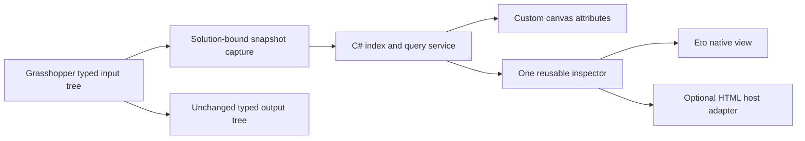

# Panel+ implementation proposal

Target: Grasshopper 1 in Rhino 8, Windows and macOS. This document records the original design proposal. The repository now implements the native canvas + Eto inspector MVP in `src/`, with a pure C# query core and HopperWire-style Yak packaging. The HTML prototype remains a separate UI study. See the README for implemented features and current validation; production Rhino performance has not yet been benchmarked.

## Product behavior

Make the canvas panel the primary workspace for inspecting data: item and branch counts, a virtual row window, search, type filtering, sorting, branch and row jumps, compact statistics, and resizing. At low zoom, render a summary rather than unreadable rows. The optional modeless inspector provides more room for full values and deeper statistics.

The first version should inspect any Grasshopper data type while passing the original typed tree through unchanged. Display filters and sorting never silently change downstream data. Preserve `{path}[original index]` identities, even when rows are sorted across branches. If users later want to output filtered data, make that an explicit operation with a defined policy for paths, empty branches, and item reindexing.

Start with substring search, type and null/invalid filters, numeric predicates, branch/prefix navigation, source/value sorting, full-value inspection and copy, and scoped statistics. Follow with pin/freeze, compare snapshots, keyboard row navigation, CSV export, branch-size outliers, and optional geometry highlighting. Avoid interpreting arbitrary text as numbers or converting geometry to strings for downstream output. Read-only inspection is not yet a replacement for the stock Panel's text authoring behavior; decide whether a separate text input mode is needed.

## What the canvas can do

Grasshopper separates a document object's behavior from its `IGH_Attributes` display and interaction implementation. Custom attributes control layout, rendering, mouse interactions, popup menus and tooltips. Rendering receives the canvas and a graphics context, and participates in canvas channels. A resizable custom panel with clipped rows, hit-tested controls and its own scroll state is feasible. It does not require an embedded browser.

Treat the canvas as a drawing surface, not a container of independent native widgets. A webview positioned over every component would require coordinating canvas pan, zoom, clipping, DPI, focus and stacking while carrying browser startup/memory costs. This is an engineering inference from the drawing API and browser hosting requirements, not a claim that overlays are technically impossible. The implementation uses Grasshopper's own temporary text input overlay for editing canvas fields; dropdown choices and rows are drawn directly on the canvas.

Use the Grasshopper drawing facilities supported by the targeted Rhino SDK on each platform; don't assume a Windows-specific control can be hosted on Mac. Verify custom attributes and interactions on both platforms early.

## Shared engine, interchangeable inspector

Implement a tree-input/tree-output component using generic Grasshopper data and custom attributes. An isolated core library owns query descriptors, row addresses, branch indexes and statistics. A session service owns current snapshot versions and inspector bindings. An optional Rhino `.rhp` host can register a dockable panel if docking is desirable; don't require that additional packaging for a first modeless inspector.

Eto provides a cross-platform UI route, and Rhino supports dockable Eto panels on Windows and Mac. A native `Drawable` with a virtual row window is a reasonable baseline; validate any grid control's virtualization rather than assuming it exists. This offers minimal dependencies and straightforward app integration.

An HTML inspector is attractive for layout iteration, tables and charts. Windows can use WebView2; Mac needs a supported web host. Do not assume `Eto.Forms.WebView` has identical engines or JS/message behavior in every Rhino 8 service release. Run a small hosting spike for the minimum supported versions, JS bridge, offline assets, focus, keyboard, DPI, clipboard and lifecycle. Choose native Eto if the supported browser engines are not reliable enough. Keep the query engine independent so this decision doesn't rewrite the data logic.

For a web UI, send `Query(snapshotVersion, viewVersion, filters, sort)` and `GetRows(viewVersion, offset, limit)` messages. Return counts, statistics and only a small row page. Keep full trees and geometry in .NET, and use structured messages rather than interpolating values into executable JS. Reuse one inspector host, and initialize it on demand. The HTML prototype's worker simulates this service; it is not the proposed production data owner.

A separate browser can be an optional large-screen mode later. It adds loopback transport, session association, disconnect handling and another app context. It is not necessary to make the panel fast.

## Where speed comes from

1. **Capture once per relevant solution.** Record branch paths and offsets, original indexes, type tags, primitive values and validity. Avoid repeatedly using a flattened linear index lookup; enumerate branches or items once. Do not duplicate or stringify heavy geometry unnecessarily. Benchmark capture separately: it may be the bottleneck even with a virtual UI.
2. **Respect ownership and threads.** Capture from stable solution data on the appropriate Rhino/Grasshopper thread. Background tasks receive immutable managed values, never a live mutable `GH_Structure` or arbitrary third-party goo. Type name, validity and formatting adapters can invoke plug-in code; don't assume they are thread-safe or inexpensive. Perform unknown conversions in bounded UI-thread batches or on demand. Retain only necessary references and release them on component/document disposal.
3. **Render the visible window.** Fixed row heights make the first visible row a constant-time calculation. Draw only visible rows plus overscan, clip to panel bounds, cache truncated display strings and text layout, and avoid allocations proportional to total data inside `Render`. Virtualize a large branch browser too.
4. **Separate queries from repaint and solving.** Use row-ID arrays/bitsets and branch-prefix indexes. Debounce typing, cancel old queries, and reject stale snapshot/view responses. Filters change the view and repaint; they should not expire the Grasshopper solution. Typed numeric sort compares numbers, mixed types have an explicit grouping policy, and stable ties retain source identity.
5. **Compute stats on the right scope.** All data, selected branch, or current results must be labeled. Basic count, min/max/mean and type counts can share one pass. Define null, invalid, NaN/infinity and numeric-subtype behavior. Compute exact quantiles/uniqueness on demand or label sampled results. Never show sampled statistics as exact.
6. **Control live updates.** Coalesce repeated solutions, show the version being inspected, preserve selection by source identity when possible, and offer a frozen snapshot. A view filter never changes the data being passed through.

Suggested targets to measure, not promises: steady scroll and paint within a 16.7 ms frame budget; immediate keyboard feedback; cancelable filtering with fresh results within roughly 100 ms for 100k primitive items on a named reference machine. Measure cold inspector open, solution capture, formatting, filter, sort, page transfer and memory separately. Include 1 million items, many tiny branches, one huge branch, empty branches, null/invalid goo, long text, and geometry on both platforms. Compare identical workloads against the stock Panel.

## First implementation milestones

1. Agree on the interaction using this mock. Decide whether the inspector should be native or HTML after the cross-platform hosting spike.
2. Build the smallest `.gha`: tree input, unchanged output, cached summary and virtual canvas rows. Measure capture and repaint with actual Grasshopper data on both platforms.
3. Implement the C# query core, stable addresses, branch lookup and stats; add a modeless inspector using the same service.
4. Add view serialization, document lifecycle cleanup, frozen snapshots and large-data benchmarks. Package against an explicitly chosen Rhino 8 minimum service release.

## Prototype coverage and limits

The mock has deterministic samples of 65,536 or 262,144 items, five types, branch navigation, substring search, numeric predicates (`>`, `<`, `>=`, `<=`, `=`), type filters, stable value sorting, visible row pages, exact current-view type counts and numeric summaries/histogram, original address inspection, copy, and two UI modes. `G` focuses path search; an exact path followed by Enter selects that branch. `/` focuses value search; Escape resets the view.

The browser worker holds generated records in memory and sends visible pages. It discards obsolete responses, but it does not interrupt a synchronous in-flight sort. Branch buttons are not virtualized in this mock. Geometry is represented by point strings, and the canvas is illustrative HTML/SVG. There is no Rhino connection, live solving, data editing, tree mutation or production runtime benchmark. Fonts use an optional Google Fonts import with local fallbacks; bundle assets locally in the shipped plug-in.

## Primary references

- [McNeel: custom Grasshopper attributes](https://developer.rhino3d.com/en/guides/grasshopper/custom-attributes/)
- [McNeel: tree properties and direct branch access](https://developer.rhino3d.com/api/grasshopper/html/Properties_T_Grasshopper_Kernel_Data_GH_Structure_1.htm) (the live reference currently describes Rhino 9; verify members against the Rhino 8 SDK used to compile)
- [McNeel: Rhino tabbed panels](https://developer.rhino3d.com/en/guides/rhinocommon/tabbed-panels/)
- [McNeel: Eto guides](https://developer.rhino3d.com/en/guides/eto/)
- [McNeel: asynchronous UI considerations](https://developer.rhino3d.com/en/guides/eto/async/)
- [Microsoft: WebView2 performance](https://learn.microsoft.com/en-us/microsoft-edge/webview2/concepts/performance)
- [Eto: WebView API source](https://github.com/picoe/Eto/blob/develop/src/Eto/Forms/Controls/WebView.cs)
